# Energy and Mass Budget

Phosphoros is an energy plan before it is anything else. This page shows where every joule comes from and
where it goes, and checks that supply covers demand. It does, with room to spare. The numbers come from
[calc/src/model/budget.ts](../calc/src/model/budget.ts) and the modules it reads; the [ledger](numbers.md)
gives each one's formula and inputs.

## The energy budget

<!-- table:budget -->
| Task | Light the Lattice delivers |
| --- | --- |
| Launch [1.0 × 10¹⁸ kg](numbers.md#ice-mass) of ice from Ceres | [6.5 × 10²⁵ J](numbers.md#ice-launch-light) |
| Pump the heat out of Venus's air | [1.5 × 10²⁸ J](numbers.md#traj-pump-energy) |
| Run the chimney fans | [2.9 × 10²⁵ J](numbers.md#traj-fan-energy) |
| Warm the air and melt the ice | [1.7 × 10²⁴ J](numbers.md#traj-warm-energy) |
| Forge [0.25 bar](numbers.md#o2-target-pressure) of oxygen | [3.5 × 10²⁵ J](numbers.md#forge-light) |
| Build the Foundry, the Veil, the Lattice and the hardware at Venus | [6 × 10²² J](numbers.md#hardware-energy) |
| **Total demand** | **[1.6 × 10²⁸ J](numbers.md#budget-demand)** |
| Supply: the Lattice from full power to the deadline | [2.2 × 10²⁸ J](numbers.md#helios-supply) |
| Spare | [30%](numbers.md#budget-spare) |
<!-- /table -->

<!-- figure:lattice-budget -->

<!-- /figure -->

Every row is counted in the light the Helios Lattice beams. The heat pumps and the warming take that light
directly: the Exhaust's tiles are pumped by it ([Photonic Exhaust](technologies/exhaust.md)). What runs on
electricity, the Railheads on Ceres and the Forges and chimney fans at Venus, takes its light through
receivers that turn [75%](numbers.md#helios-receiver-efficiency) of it into power, so those rows include the
receivers' loss.

The plan needs [1.6 × 10²⁸ J](numbers.md#budget-demand) of light from outside Venus and Ceres. The Lattice
beams [2.2 × 10²⁸ J](numbers.md#helios-supply): [2.2 × 10²⁰ W](numbers.md#helios-power) for the
[3.2 yr](numbers.md#helios-supply-years) from full power on
[9 October 2033](numbers.md?date=day#helios-full-power) to the deadline. That leaves
[30%](numbers.md#budget-spare) spare ([check](numbers.md#check-energy-closes)). Pumping the heat out and
launching the water take [69%](numbers.md#budget-launch-share) of the Lattice's output, and the pumps take
nearly all of that; oxygen, fans, warming and hardware are small change.

The supply counts the Lattice only from full power to the deadline. The launches start the day the Lattice
reaches full power, and cooling on [23 February 2034](numbers.md?date=day#cooling-start), once the hardware
has reached Venus, so every large row falls inside those years. Building the hardware, which the Foundry
mostly does on its own power, is charged against the Lattice's light all the same: an overcount, and a small
one.

<!-- figure:energy-sankey -->

<!-- /figure -->

## Calculation walkthrough

### The atmosphere's heat

The heat to remove is Q = M c_p ΔT + M_CO₂ L. The whole atmosphere,
[4.8 × 10²⁰ kg](numbers.md#venus-atmosphere-mass) with a heat capacity of
[1,000 J/(kg·K)](numbers.md#co2-cp), cools from [737 K](numbers.md#venus-surface-temp) to
[195 K](numbers.md?sig=3#freeze-target-temp): [2.6 × 10²⁶ J](numbers.md#atmosphere-sensible-heat). Its
[4.69 × 10²⁰ kg](numbers.md#venus-co2-mass) of CO₂ gives up [571 kJ/kg](numbers.md#co2-deposition-heat)
as it condenses and freezes: [2.7 × 10²⁶ J](numbers.md#atmosphere-latent-heat). Together,
[5.3 × 10²⁶ J](numbers.md#atmosphere-heat).

This heat is Venus's own. With the heat the Bricks and the machines add while the pumps run, it leaves the
planet as light, [7.3 × 10²⁶ J](numbers.md#venus-heat-out) of it, and the Lattice does not supply it. The
Lattice pays for moving it.

### Pump work at the light's temperature

> **Physics:** A heat pump that moves heat dQ from a cold side at T_c to a hot side at T_h needs at least
> dW = dQ (T_h / T_c − 1) of work. No machine does better.

The Exhaust's pumps lift heat into light, so the hot side is the light itself, and light carries entropy at a
temperature set by how bright it is in each colour and direction. The tiles shine
[1.3 MW/m²](numbers.md#exhaust-flux), as much as a black body at
[2,200 K](numbers.md#exhaust-effective-temp), but only in a [0.4 µm](numbers.md#exhaust-band) band around
[2.3 µm](numbers.md#exhaust-wavelength): each mode of that light holds
[0.57](numbers.md#exhaust-photons-per-mode) photons on average, so by its entropy it counts as
[3,500 K](numbers.md#exhaust-light-temp), [1.6](numbers.md#exhaust-light-vs-effective) times the effective
temperature. The tiles spread it evenly over the sky above them, the least entropy light that bright can
carry, and every pump in the model, the simulation's included, is charged as if it rejected its heat at that
temperature. The pumps reach [50%](numbers.md#exhaust-carnot-share) of the Carnot limit, about what good
industrial heat pumps do ([check](numbers.md#check-second-law)).

The cold side is the air itself, which starts at [737 K](numbers.md#venus-surface-temp) and ends at
[195 K](numbers.md?sig=3#freeze-target-temp). Summing dW along the cooling path gives
[4.2 × 10²⁷ J](numbers.md#exhaust-work-sensible) for the sensible cooling and
[6.7 × 10²⁷ J](numbers.md#exhaust-work-latent) for the latent heat, which comes out when the air is cold and
each joule is dearest: [1.09 × 10²⁸ J](numbers.md#exhaust-work) of light in all, or
[21](numbers.md#exhaust-work-ratio) joules of light per joule of heat moved.

The light pumps the tiles directly. Each photon the Lattice sends, at
[2.5 µm](numbers.md#helios-wavelength), lies a little below the tiles'
[0.54 eV](numbers.md#exhaust-bandgap) bandgap, and leaves as one of the tile's own, carrying heat as well.
From the hottest starting air a joule of pumping light has room for
[0.26](numbers.md#exhaust-pump-room-start) J of heat; the model has it carry
[0.12](numbers.md#exhaust-cop-start) J, and less as the air cools
([check](numbers.md#check-exhaust-pump-photons)).

### Only the lit side works

The Lattice orbits inside Venus's orbit, so it sees only Venus's sunward side, and only the tiles there can be
pumped: [50%](numbers.md#exhaust-lit-share) of them at once. The lit tiles must shine for the whole planet,
so the area installed is the area working at the peak divided by that share, and only the lit canopies'
chimneys carry heat, [1.8 × 10¹⁹ W](numbers.md#chimney-capacity-lit) of them.

The tiles' brightness is a trade. Dimmer tiles need less light per joule lifted but far more area: at the
dimmest option the model lists, tiles would need [390%](numbers.md#exhaust-area-share-1000) of Venus, at the
next [120%](numbers.md#exhaust-area-share-1500), and at the brightest
[36%](numbers.md#exhaust-area-share-2500), for more light. The ledger gives each option's temperature. At [2,200 K](numbers.md#exhaust-effective-temp) the
[3.3 × 10¹⁴ m²](numbers.md#exhaust-area-installed) of tiles cover [72%](numbers.md#exhaust-area-share) of
Venus: [83%](numbers.md#canopy-band-cover) of the band within [60°](numbers.md#ice-drop-latitude) of the
equator, which leaves the poles to the falling ice ([check](numbers.md#check-exhaust-fits-venus)). The
Exhaust throws the heat and the light that lifted it into space together,
[1.1 × 10²⁸ J](numbers.md#exhaust-rejected), an average of
[1.4 × 10²⁰ W](numbers.md#exhaust-rejected-avg) over the [2.5 yr](numbers.md#cooling-seconds) of cooling.

### Why the simulation pumps more

The budget does not charge [1.09 × 10²⁸ J](numbers.md#exhaust-work). It charges what the day-by-day
[simulation](plan.md#the-simulated-atmosphere) actually spends, [1.5 × 10²⁸ J](numbers.md#traj-pump-energy).
The difference has three causes.

- **Heat keeps arriving.** While the pumps run, [2.0 × 10²⁶ J](numbers.md#traj-heat-added) enters the air.
  Most of it is the Bricks' fall, [1.5 × 10²⁶ J](numbers.md#ice-entry-heat) ([below](#the-bricks-fall));
  the rest comes from the crust, from the Forges' waste heat, from the fans' work, from the receivers at
  Venus, which shed [2.9 × 10¹⁷ W](numbers.md#venus-receiver-loss) at full output, and from the sunlight the
  closed Veil lets through.
- **It arrives when pumping is dearer.** The Bricks fall from
  [13 November 2034](numbers.md?date=day#first-arrival) to
  [23 January 2035](numbers.md?date=day#last-arrival), after the Clear Rain has begun on
  [8 August 2034](numbers.md?date=day#traj-clear-rain), so their heat is lifted from air already below
  [304.1 K](numbers.md#co2-critical-temp). Their water gives up its heat as it rains out, from
  [26 November 2034](numbers.md?date=day#traj-water-rain), and as it freezes, on
  [30 June 2035](numbers.md?date=day#traj-water-frozen), when every joule costs more than the campaign's
  average of [21](numbers.md#exhaust-work-ratio). The simple estimate also spreads all the latent heat
  between the critical and triple points, where the simulation lifts the seas' heat of fusion,
  [210 kJ/kg](numbers.md#co2-fusion-heat), at the triple point itself.
- **The Frost Towers.** Trapping the last [5.4 × 10¹⁸ kg](numbers.md#frost-residual-co2) of CO₂ at
  [133 K](numbers.md#frost-tower-temp) takes about [1.5 × 10²⁶ J](numbers.md#frost-work) more.

After the caps are sealed, the beamed light also warms the air and melts the water that froze while the air
was cold. The opened Veil's sunlight does most of that, so it takes only
[1.7 × 10²⁴ J](numbers.md#traj-warm-energy) of the Lattice's light. Version 2 charged only the simple
estimate; counting the simulation is most of why the demand rose ([correction](about.md#corrections)).

### The Bricks' fall

Nothing catches the Bricks. Each one falls into the air beyond [60°](numbers.md#ice-drop-latitude) of
latitude at [17.1 km/s](numbers.md#ice-entry-speed), and all of its motion becomes heat: its speed far out,
[13.7 km/s](numbers.md#ice-vinf-rms) on average, and its whole fall into Venus's gravity. That is
[147 MJ/kg](numbers.md#ice-entry-energy-per-kg), far more than the
[0.61 MJ/kg](numbers.md#melt-energy) it takes to melt the ice and warm it to
[288 K](numbers.md#earth-surface-temp). For
[1.0 × 10¹⁸ kg](numbers.md#ice-mass) of ice it comes to [1.5 × 10²⁶ J](numbers.md#ice-entry-heat),
[28%](numbers.md#ice-entry-vs-atmosphere) of the heat the pumps must take out of the air itself, and the
simulation lifts every joule of it.

> **Physics:** No way of stopping the ice avoids this heat. It is the ice's fall into the Sun's gravity well
> and into Venus's, and it ends as heat wherever the ice is stopped. An ocean in Earth's proportion would
> bring [350](numbers.md#ocean-entry-vs-atmosphere) times the atmosphere's own heat. That is why Venus gets
> seas [2.17 m](numbers.md#ocean-depth) deep if spread over the globe, not oceans.

Version 3 planned to catch the ice on a Braking Ring and turn its speed into electricity. The Ring could
not hold the catch's push, lower the ice or carry its receivers, so version 4 retires it and ships a
hundredth of the water ([correction](about.md#corrections)).

### Launching the ice

Each Brick leaves Ceres at [6.4 km/s](numbers.md#ice-launch-speed) in a launch window. Its motion energy is
½v² per kilogram, and the Railheads turn electricity into motion at
[50%](numbers.md#railhead-efficiency), so each kilogram draws
[41 MJ/kg](numbers.md#launch-energy-per-kg) in a window. The campaign is short,
[90 d](numbers.md#ice-campaign-days) from [9 October 2033](numbers.md?date=day#ice-launch-start), and the
model books it on its real dates: that day Venus leads Ceres by [214°](numbers.md#ice-launch-lead),
[7.9 d](numbers.md#ice-window-wait) before a Hohmann window, so the first shots cost about a Hohmann launch
and the later ones more, up to [50%](numbers.md#launch-offwindow-max) more,
[19%](numbers.md#launch-offwindow-mean) on average. So each kilogram draws
[48.9 MJ/kg](numbers.md#launch-energy-per-kg-avg), and [1.0 × 10¹⁸ kg](numbers.md#ice-mass) takes
[4.9 × 10²⁵ J](numbers.md#ice-launch-energy) of electricity at [6.3 × 10¹⁸ W](numbers.md#railhead-power):
[6.5 × 10²⁵ J](numbers.md#ice-launch-light) of the Lattice's light through Ceres's receivers
([check](numbers.md#check-railheads-within-lattice)). Of that electricity,
[7.9 × 10²⁴ J](numbers.md#ice-launch-offwindow-energy) is the price of firing away from the window.

### Forging the oxygen

Splitting a mole of CO₂ into carbon and oxygen takes at least [394 kJ/mol](numbers.md#co2-split-enthalpy).
At [60%](numbers.md#forge-efficiency) efficiency the Forges spend [656 kJ/mol](numbers.md#forge-energy-per-mol).
Making [4.1 × 10¹⁹ mol](numbers.md#o2-moles) of oxygen therefore takes
[2.7 × 10²⁵ J](numbers.md#forge-energy), [5.6 × 10¹⁷ W](numbers.md#forge-power) for
[18 months](numbers.md#forge-seconds), and their receivers take
[3.5 × 10²⁵ J](numbers.md#forge-light) of light to make it. The
[1.1 × 10²⁵ J](numbers.md#forge-waste-heat) lost as heat goes into the air, with the receivers' own loss,
and the simulation pumps both out.

### Building the hardware

Everything the Foundry builds, itself included, about [5.8 × 10¹⁴ kg](numbers.md#foundry-built-mass), costs
[100 MJ/kg](numbers.md#foundry-energy-per-kg) to make from regolith: [6 × 10²² J](numbers.md#hardware-energy),
a rounding error. The largest part after the Foundry itself is the
[1.9 × 10¹⁴ kg](numbers.md#venus-hardware-mass) of tiles, chimneys, receivers and Lanterns at Venus. Once
the Foundry runs, matter is cheap. Energy is the cost.

## The mass budget

<!-- table:mass -->
| Mass item | Amount | From |
| --- | --- | --- |
| Ouroboros machinery at peak | [2.7 × 10¹⁴ kg](numbers.md#foundry-final-mass) | Mercury regolith |
| Helios Lattice | [1.2 × 10¹⁴ kg](numbers.md#helios-mass) | Mercury |
| Hesperus Veil | [5.4 × 10¹¹ kg](numbers.md#veil-mass) | Mercury |
| Tiles, chimneys, receivers and Lanterns for Venus | [1.9 × 10¹⁴ kg](numbers.md#venus-hardware-mass) | Mercury |
| Ceres factories at peak | [6.7 × 10¹³ kg](numbers.md#ceres-final-mass) | Ceres rock |
| Railheads and Crown | [6.5 × 10¹³ kg](numbers.md#ceres-build-mass) | Ceres |
| Water delivered | [1.0 × 10¹⁸ kg](numbers.md#ice-mass) | Ceres ([0.39%](numbers.md#ice-ceres-water-share) of its water) |
| CO₂ sealed in cryo-continents | [4.69 × 10²⁰ kg](numbers.md#venus-co2-mass), [3.0 × 10¹⁷ m³](numbers.md#cryo-volume) | Venus's air |
| Oxygen made | [1.3 × 10¹⁸ kg](numbers.md#o2-mass) | Split from Venus's CO₂ |
| Graphite made | [4.9 × 10¹⁷ kg](numbers.md#forge-graphite) | Forge by-product |
<!-- /table -->

The Foundry makes every piece of hardware from Mercury rock, and the Ceres factories make the Railheads and
the Crown from Ceres's; only their two seeds leave Earth. The largest mass the plan moves is Venus's own CO₂,
which never leaves the planet: it is frozen in place. The largest mass it imports is the water.

## Physics checks

Every run of the model tests these. A check is a law of physics or a requirement of the plan.

<!-- table:checks -->
| Check | Result | Detail |
| --- | --- | --- |
| [Version 2: a statite Veil 137,000 km sunward of Venus can hover](numbers.md#check-veil-v2-hovers) | **Fails (open issue)** | Light pressure (0.0174 m/s²) and Venus's gravity both point toward Venus; the shade falls with 0.0347 m/s² and reaches Venus in about 1 d. |
| [A station exists where gravity, light pressure and orbital motion balance on the Veil](numbers.md#check-veil-hovers) | Pass | At 1.11 × 10⁶ km sunward of Venus the forces on a Veil with a lightness of 0.0077 balance. The point is unstable along the Sun line, so holding it takes constant trimming, by tilting slats, which the model does not size. |
| [Gaps and closed slats together leak no more than the Veil may](numbers.md#check-veil-leak-fits) | Pass | Gaps of 0.05% plus 0.03% through the closed slats, against the 0.1% the closed Veil may let through. |
| [The tiles fit in the band between the drop zones, the lit ones on the side the Lattice sees](numbers.md#check-exhaust-fits-venus) | Pass | The lit tiles throw out 2.2 × 10²⁰ W at 1.3 MW/m², and only 50% of them are lit at once, so the tiles cover 72% of Venus: 83% of the band within 60° of the equator, which leaves the poles to the falling ice. |
| [The heat pumps are charged more than the reversible work](numbers.md#check-second-law) | Pass | The pumps reach 50% of the Carnot limit, so the model charges 1.09 × 10²⁸ J of work for 5.3 × 10²⁶ J of heat, more than the 2.0 × 10²⁷ J even a reversible pump would need if every joule left from 737 K. |
| [The Exhaust's light adds little to the sunlight the Veil turns away](numbers.md#check-exhaust-spares-veil) | Pass | Seen from Venus the Veil is 0.68° in radius, so the lit tiles send it 0.007% of their light: 1.5 × 10¹⁶ W at the Exhaust's peak, 5.1% of the 3.0 × 10¹⁷ W of sunlight it turns away. It pushes the Veil toward the Sun, against the sunlight, and the slats that trim its station take it up. |
| [Each pump photon leaves the tile with room for the heat the model has it carry](numbers.md#check-exhaust-pump-photons) | Pass | Pumped at 2.5 µm, below the tiles' 0.54 eV bandgap, each photon leaves at least 0.54 eV plus the heat of the tile it crossed. From the hottest starting air a joule of pumping light can carry 0.26 J of heat; the model has it carry 0.12 J, and less as the air cools. |
| [The Forges make the cap graphite before sealing ends](numbers.md#check-graphite-for-caps) | Pass | 4.6 × 10¹⁷ kg of graphite by the end of sealing; the caps need 2.5 × 10¹⁷ kg. |
| [The last Brick reaches Venus while the pumps still run](numbers.md#check-ice-arrives) | Pass | Launches run from 9 October 2033 to 7 January 2034. The slowest transfer takes 410 d, and the last Brick falls into the air on 23 January 2035, before the pumps stop with the last caps on 1 September 2036. Its heat is the pumps' to take out. |
| [Ceres's surface can radiate the heat left on the ground](numbers.md#check-ceres-ground-heat) | Pass | All the heat made at Ceres is 6.6 times what its whole surface could radiate at 1,500 K (8.0 × 10¹⁷ W), so the Crown sheds it in space; the barrels leave 6.3 × 10¹⁵ W on the ground, radiators over 0.79% of the surface. |
| [Ceres's receivers shed heat no faster than a cooled surface already does](numbers.md#check-ceres-receiver-cooling) | Pass | At 40 MW/m² each square metre of receiver hands 10 MW/m² to its coolant, against the 10 MW/m² ITER's divertor is built to carry; left to radiate it alone, a receiver would reach 3,100 K. |
| [The Crown stays deep inside Ceres's Hill sphere, and the recoil cannot shake it off](numbers.md#check-crown-orbit) | Pass | The Crown circles at 1,190 km and its fins reach 2,100 km, well inside half of Ceres's 220,000 km Hill radius, where orbits around a small body stay bound; Ceres's recoil, 9.1 × 10⁻⁷ m/s², is small beside its 0.014 m/s² pull even at the fins' edge. |
| [Carbon-fibre tethers can hang from the Crown to Ceres's surface](numbers.md#check-crown-tethers) | Pass | Summed from the surface to the Crown, Ceres's net pull on a tether is 59 kJ/kg, against the 3.9 MJ/kg carbon fibre holds at full strength; hanging the 8.1 × 10¹¹ kg of cables and holding the beams' 2.8 × 10¹⁰ N push takes 1.8 × 10¹⁰ kg of fibre. |
| [The first launch waits for Ceres's factories, whose seed leaves with the Foundry's](numbers.md#check-ceres-ready-in-time) | Pass | The seed leaves Earth on 1 October 2028, with the Foundry's once Ouroboros-0 has passed, and lands on 16 January 2030; doubling every 45 d, the factories finish the 6.5 × 10¹³ kg of Railheads and Crown on 2 June 2033, against a first launch on 9 October 2033. |
| [The Lattice can power the Railheads](numbers.md#check-railheads-within-lattice) | Pass | Throwing 1.0 × 10¹⁸ kg in 0.25 yr takes 6.3 × 10¹⁸ W, which Ceres's receivers make from 8.4 × 10¹⁸ W of the Lattice's 2.2 × 10²⁰ W. |
| [Ceres's new orbit stays clear of Jupiter](numbers.md#check-ceres-clear-of-jupiter) | Pass | At its new aphelion Ceres stays 2.18 AU inside Jupiter's closest approach to the Sun, 6.1 of Jupiter's Hill radii against the 2√3 that keeps two orbits from meeting; its Tisserand parameter falls from 3.31 to 3.31, still above the 3 below which Jupiter takes control. |
| [Building the Veil costs the Foundry no more than one doubling](numbers.md#check-foundry-affords-veil) | Pass | The Foundry stands still for 9.8 d to build the 5.4 × 10¹¹ kg Veil, whose last parts leave Mercury on 16 September 2032; one doubling is 60 d. |
| [The Foundry stops growing at the size that finishes the Lattice and the hardware at Venus soonest](numbers.md#check-foundry-size) | Pass | After 28 doublings the 2.7 × 10¹⁴ kg Foundry builds the 1.2 × 10¹⁴ kg Lattice in 39 d and the 1.9 × 10¹⁴ kg of hardware at Venus in 61 d: both done 1780 days after landing, against 1821 with one doubling fewer and 1790 with one more. |
| [The Foundry can build the structure that holds the Aegis coil together](numbers.md#check-aegis-structure) | Pass | The coil's field pulls on its winding with 1.2 × 10¹¹ N; holding it takes at least 2.0 × 10¹¹ kg of carbon fibre at full strength, 0.063 days of the full Foundry's output against the 60 d of one doubling. |
| [The Forges start once the liquid CO₂ seas are there for good](numbers.md#check-forges-on-seas) | Pass | The Forges float on the seas from April 2035; the Clear Rain begins for good on January 2035. |
| [The simulation's heat books balance: it lifts every joule it counts in](numbers.md#check-traj-heat-books) | Pass | The Exhaust lifts 7.3 × 10²⁶ J: Venus's 5.3 × 10²⁶ J, less the 1.6 × 10²¹ J still held by the CO₂ the Frost Towers leave in the air, plus 2.0 × 10²⁶ J that enters while the pumps run. The two sides agree to rounding. This confirms the simulation's own bookkeeping; a heat source the simulation leaves out cannot show here. |
| [The seas are frozen through before the last caps are sealed](numbers.md#check-frozen-before-sealing) | Pass | The simulated seas are frozen through on 30 April 2036, leaving 120 d to the last cap on 1 September 2036: the crawler-rafts must lay 1.2 × 10⁶ km²/d. |
| [The Frost Towers finish before the last caps are sealed](numbers.md#check-frost-before-sealing) | Pass | The simulated Frost Towers finish on 26 June 2036; the last caps are sealed on 1 September 2036. |
| [Seeded life greens the seas by the deadline](numbers.md#check-genesis-by-deadline) | Pass | Seeding waits for the oxygen (30 September 2036) and for the seas to hold their pH (1 December 2036), so it begins on 1 December 2036; doubling every 1 d, the cells reach bloom density on 12 December 2036, against a deadline of 31 December 2036. |
| [The simulated atmosphere is Earth-like by the deadline](numbers.md#check-earth-like-by-deadline) | Pass | The day-by-day simulation reaches Earth-like conditions on 30 September 2036, 92 d before the 31 December 2036 deadline. The chimneys, not the power, set the pace on 51 d of it. |
| [The ozone model, run on Earth's air, gives Earth's ozone column](numbers.md#check-ozone-model-earth) | Pass | 280 DU against 279 DU from a three-dimensional model of the pre-industrial Earth, within a quarter either way, with nothing fitted. |
| [The ozone shields the land before the deadline](numbers.md#check-ozone-shield-in-time) | Pass | One day of sunlight makes 49.9 DU, easily measured. The column reaches 185 DU on 2 December 2036, 91 d after the Veil opens, so lichens and mosses go onto land from 2 December 2036, against a deadline of 31 December 2036. |
| [The energy budget closes: supply covers demand](numbers.md#check-energy-closes) | Pass | The Lattice beams 2.2 × 10²⁸ J from full power to the deadline, against 1.6 × 10²⁸ J the plan needs: 30% spare. |
<!-- /table -->

[1](numbers.md#checks-failing) of the [28](numbers.md#checks-total) checks fails, and it is shown on purpose.

**The version 2 statite.** This check tests version 2's Veil, not the current one, and it is kept failing
so the error stays visible. Version 2 put the Veil [137,000 km](numbers.md?sig=3#veil-v2-distance) sunward of
Venus, hovering on light pressure. But sunlight pushes away from the Sun, toward Venus, with
[0.0174 m/s²](numbers.md#veil-v2-light-accel), and Venus's gravity pulls the same way. The net
[0.0347 m/s²](numbers.md#veil-v2-net-accel) would drop the shade onto Venus in about
[1 d](numbers.md#veil-v2-fall-days). The version 3 Veil near L1 passes its own check.

**What version 4 closed.** Version 3 ended with five more failing checks: the Braking Ring could not lower
the ice, could not pass the catch's push to Venus and could not carry its receivers; the receivers' loss
heat fell on Venus; and the Exhaust's beamed light carried more entropy than the pumps were charged for.
Version 4 changes the design, never the physics, to close them. The Ring is gone and the Bricks fall straight
into the air, the light pumps the tiles directly, the tiles spread their light over their whole sky, and the
pumps are charged at the light's temperature. Each fix is recorded with the numbers it changed on the
[About page](about.md#corrections).

**The tiles and the lit side.** Only the lit half of the tiles work at once, so they fill
[83%](numbers.md#canopy-band-cover) of the band between the drop zones
([check](numbers.md#check-exhaust-fits-venus)). Much dimmer tiles would not fit: the next option down in the
ledger needs [120%](numbers.md#exhaust-area-share-1500) of Venus.

**Freezing the seas.** The tightest stretch of the schedule. At the triple point,
[216.6 K](numbers.md#co2-triple-temp), the seas give up their heat of fusion while the air holds there, with
the lit tiles at their peak all through it. The seas start to freeze on
[7 November 2035](numbers.md?date=day#traj-freeze) and are frozen through on
[30 April 2036](numbers.md?date=day#traj-frozen). All the CO₂ is down on
[17 June 2036](numbers.md?date=day#traj-cold) and the Frost Towers finish on
[26 June 2036](numbers.md?date=day#traj-scavenged), [67 d](numbers.md#frost-sealing-slack) before the last caps
are due on [1 September 2036](numbers.md?date=day#sealing-end). The ice melts and the seas start their pH hold
when the Veil opens, on [2 September 2036](numbers.md?date=day#traj-warming), so seeded life greens them on
[12 December 2036](numbers.md?date=day#genesis-end), before the deadline. With the Exhaust's peak a tenth
lower, both the Frost Towers and seeded life miss their dates.

**The Bricks' heat.** The water the plan ships is sized to what the pumps can lift. Twice
[1.0 × 10¹⁸ kg](numbers.md#ice-mass) brings twice the entry heat, and the Frost Towers then finish after the
last caps are due ([check](numbers.md#check-frost-before-sealing)). The fall's heat, not the Railheads or the
budget, is what limits the water.

## How much room the plan has

Each row moves one assumption alone, across the range the [Explorer](https://phosphoros.space/explore) lets a reader try, with
everything else as planned, and finds where a check that passes today first fails. Most of the plan's
schedule hangs on one date: the Frost Towers must have the CO₂ down before the last caps are sealed on
[1 September 2036](numbers.md?date=day#sealing-end), and they finish only
[67 d](numbers.md#frost-sealing-slack) before it.

<!-- table:margins -->
| Assumption | Plan | The plan holds from | to | What breaks first |
| --- | --- | --- | --- | --- |
| Water share of Ceres's mass | [27%](numbers.md?sig=3#ceres-water-fraction) | 17% or less | 35% or more | Nothing, across the whole range |
| Seed foundry mass | [1,000 t](numbers.md?sig=3#foundry-seed-mass) | 716 t | 9,640 t | Lower: [The Frost Towers finish before the last caps are sealed](numbers.md#check-frost-before-sealing). Higher: [Building the Veil costs the Foundry no more than one doubling](numbers.md#check-foundry-affords-veil) |
| Foundry doubling time | [60 d](numbers.md?sig=3#foundry-doubling-days) | 52.8 d | 61.3 d | Lower: [Building the Veil costs the Foundry no more than one doubling](numbers.md#check-foundry-affords-veil). Higher: [The Frost Towers finish before the last caps are sealed](numbers.md#check-frost-before-sealing) |
| Energy to make a kilogram of machinery from regolith | [100 MJ/kg](numbers.md?sig=3#foundry-energy-per-kg) | 30 MJ/kg or less | 300 MJ/kg or more | Nothing, across the whole range |
| Light the Helios Lattice beams out | [2.20 × 10²⁰ W](numbers.md?sig=3#helios-power) | 1.95 × 10²⁰ W | 3.00 × 10²⁰ W or more | Lower: [The Frost Towers finish before the last caps are sealed](numbers.md#check-frost-before-sealing) |
| Hot-film solar cell efficiency at about 460 K | [40%](numbers.md?sig=3#helios-film-efficiency) | 25% or less | 50% or more | Nothing, across the whole range |
| Electricity-to-laser efficiency | [50%](numbers.md?sig=3#helios-laser-efficiency) | 30% or less | 70% or more | Nothing, across the whole range |
| Share of sunlight's momentum the light-bending film takes up | [0.01](numbers.md?sig=3#veil-momentum-fraction) | 0.002 or less | 0.0944 | Higher: [The Frost Towers finish before the last caps are sealed](numbers.md#check-frost-before-sealing) |
| Effective temperature the emitters shine at | [2,200 K](numbers.md?sig=3#exhaust-effective-temp) | 2,100 K | 2,300 K | Lower: [The tiles fit in the band between the drop zones, the lit ones on the side the Lattice sees](numbers.md#check-exhaust-fits-venus). Higher: [The Frost Towers finish before the last caps are sealed](numbers.md#check-frost-before-sealing) |
| Share of the Carnot limit the heat pumps reach | [50%](numbers.md?sig=3#exhaust-carnot-share) | 46.1% | 90% or more | Lower: [The Frost Towers finish before the last caps are sealed](numbers.md#check-frost-before-sealing) |
| Peak power the Exhaust's lit tiles can throw into space | [2.20 × 10²⁰ W](numbers.md?sig=3#exhaust-peak) | 2.03 × 10²⁰ W | 2.65 × 10²⁰ W | Lower: [The Frost Towers finish before the last caps are sealed](numbers.md#check-frost-before-sealing). Higher: [The tiles fit in the band between the drop zones, the lit ones on the side the Lattice sees](numbers.md#check-exhaust-fits-venus) |
| Water shipped to Venus | [1.00 × 10¹⁸ kg](numbers.md?sig=3#ice-mass) | 3.00 × 10¹⁷ kg or less | 1.53 × 10¹⁸ kg | Higher: [The Forges start once the liquid CO₂ seas are there for good](numbers.md#check-forges-on-seas) |
| Average depth of the new seas where they lie | [300 m](numbers.md?sig=3#sea-mean-depth) | 50 m or less | 1,000 m or more | Nothing, across the whole range |
| Launch energy the schedule will spend to save one joule of arrival speed | [0](numbers.md?sig=3#ice-arrival-weight) | 0 or less | 4 or more | Nothing, across the whole range |
| Ceres seed factory mass | [1,000 t](numbers.md?sig=3#ceres-seed-mass) | 100 t or less | 10,000 t or more | Nothing, across the whole range |
| Ceres factory doubling time | [45 d](numbers.md?sig=3#ceres-doubling-days) | 30 d or less | 52.6 d | Higher: [The Frost Towers finish before the last caps are sealed](numbers.md#check-frost-before-sealing) |
<!-- /table -->

Some changes are not on a slider. The seeds launch once their own proof experiment, Ouroboros-0, has shown
mass closure, but before it and the other experiments must pass ([Research](research.md)): they are in
flight when the results come. Waiting for every result costs more than the slack:

<!-- table:scenarios -->
| What if | Simulated Earth-like | Against the deadline | Newly failing checks |
| --- | --- | --- | --- |
| The plan | 30 September 2036 | 92 d early | None |
| The seeds wait for every proof experiment to pass before they launch | 13 December 2036 | 18 d early | [The seas are frozen through before the last caps are sealed](numbers.md#check-frozen-before-sealing); [The Frost Towers finish before the last caps are sealed](numbers.md#check-frost-before-sealing); [Seeded life greens the seas by the deadline](numbers.md#check-genesis-by-deadline); [The ozone shields the land before the deadline](numbers.md#check-ozone-shield-in-time) |
<!-- /table -->

`tools/margins.ts` computes both tables by running the whole model a few hundred times.

## Every assumption

These are the plan's choices and the breakthroughs it assumes. Each links to the line that defines it, and
its basis says whether it is a design choice, an invention or a demonstrated precedent. Dates are on the
[Timeline](timeline.md).

<!-- table:assumptions -->
| Assumption | Value | Basis | Explore | Defined in | Used by |
| --- | --- | --- | --- | --- | --- |
| Temperature the air is cooled to, freezing out its CO₂ | [195 K](numbers.md#freeze-target-temp) | Design choice |  | [data/assumptions.yaml:55](../data/assumptions.yaml#L55) | [conventional.ts](../calc/src/model/conventional.ts), [exhaust.ts](../calc/src/model/exhaust.ts), [trajectory.ts](../calc/src/model/trajectory.ts) |
| How much the crust's surface cools | [400 K](numbers.md#crust-cooling-step) | Design choice |  | [data/assumptions.yaml:62](../data/assumptions.yaml#L62) | [conventional.ts](../calc/src/model/conventional.ts), [trajectory.ts](../calc/src/model/trajectory.ts) |
| Length of a fast cooling campaign, for the crust estimate (years) | [4](numbers.md#skin-campaign-years) | Design choice |  | [data/assumptions.yaml:67](../data/assumptions.yaml#L67) | [conventional.ts](../calc/src/model/conventional.ts) |
| The decade target (years) | [10](numbers.md#conventional-campaign-years) | Design choice |  | [data/assumptions.yaml:72](../data/assumptions.yaml#L72) | [conventional.ts](../calc/src/model/conventional.ts) |
| Payload of one heavy-lift launch from Earth | [100 t](numbers.md#heavy-launch-payload) | Design choice |  | [data/assumptions.yaml:77](../data/assumptions.yaml#L77) | [conventional.ts](../calc/src/model/conventional.ts) |
| Seed foundry mass | [1,000 t](numbers.md#foundry-seed-mass) | Design choice | 100 t to 10,000 t | [data/assumptions.yaml:89](../data/assumptions.yaml#L89) | [foundry.ts](../calc/src/model/foundry.ts) |
| Earth-to-Mercury transfer | [105 d](numbers.md#foundry-transfer-days) | Design choice |  | [data/assumptions.yaml:101](../data/assumptions.yaml#L101) | [foundry.ts](../calc/src/model/foundry.ts) |
| Foundry doubling time | [60 d](numbers.md#foundry-doubling-days) | Invented | 30 d to 120 d | [data/assumptions.yaml:107](../data/assumptions.yaml#L107) | [ceres.ts](../calc/src/model/ceres.ts), [foundry.ts](../calc/src/model/foundry.ts), [helios.ts](../calc/src/model/helios.ts) |
| Energy to make a kilogram of machinery from regolith | [100 MJ/kg](numbers.md#foundry-energy-per-kg) | Invented | 30 MJ/kg to 300 MJ/kg | [data/assumptions.yaml:114](../data/assumptions.yaml#L114) | [ceres.ts](../calc/src/model/ceres.ts), [foundry.ts](../calc/src/model/foundry.ts) |
| Share of each copy's mass in complex parts (chips, bearings, optics) | [2%](numbers.md#foundry-complex-share) | Invented |  | [data/assumptions.yaml:121](../data/assumptions.yaml#L121) |  |
| Smallest feature a Lithocell chip fab writes | [90 nm](numbers.md#lithocell-feature-size) | Invented |  | [data/assumptions.yaml:128](../data/assumptions.yaml#L128) |  |
| Light the Helios Lattice beams out | [2.2 × 10²⁰ W](numbers.md#helios-power) | Design choice | 1.4 × 10²⁰ W to 3.0 × 10²⁰ W | [data/assumptions.yaml:137](../data/assumptions.yaml#L137) | [cryo.ts](../calc/src/model/cryo.ts), [helios.ts](../calc/src/model/helios.ts), [trajectory.ts](../calc/src/model/trajectory.ts) |
| Hot-film solar cell efficiency at about 460 K | [40%](numbers.md#helios-film-efficiency) | Invented | 25% to 50% | [data/assumptions.yaml:144](../data/assumptions.yaml#L144) | [ceres.ts](../calc/src/model/ceres.ts), [helios.ts](../calc/src/model/helios.ts) |
| Electricity-to-laser efficiency | [50%](numbers.md#helios-laser-efficiency) | Invented | 30% to 70% | [data/assumptions.yaml:151](../data/assumptions.yaml#L151) | [helios.ts](../calc/src/model/helios.ts) |
| Receiver efficiency, laser light to electricity | [75%](numbers.md#helios-receiver-efficiency) | Invented |  | [data/assumptions.yaml:158](../data/assumptions.yaml#L158) | [budget.ts](../calc/src/model/budget.ts), [ceres.ts](../calc/src/model/ceres.ts), [foundry.ts](../calc/src/model/foundry.ts), [trajectory.ts](../calc/src/model/trajectory.ts) |
| Petal film areal density | [1 g/m²](numbers.md#helios-areal-density) | Invented |  | [data/assumptions.yaml:164](../data/assumptions.yaml#L164) | [ceres.ts](../calc/src/model/ceres.ts), [helios.ts](../calc/src/model/helios.ts) |
| Petal edge | [70 km](numbers.md#helios-petal-side) | Design choice |  | [data/assumptions.yaml:170](../data/assumptions.yaml#L170) | [helios.ts](../calc/src/model/helios.ts) |
| Beam wavelength | [2.5 µm](numbers.md#helios-wavelength) | Design choice |  | [data/assumptions.yaml:176](../data/assumptions.yaml#L176) | [exhaust.ts](../calc/src/model/exhaust.ts), [helios.ts](../calc/src/model/helios.ts) |
| Phase-locked virtual aperture width | [10 km](numbers.md#helios-aperture) | Invented |  | [data/assumptions.yaml:186](../data/assumptions.yaml#L186) | [helios.ts](../calc/src/model/helios.ts) |
| Beam intensity at the receivers at Venus, which power the Forges and the chimney fans | [10 MW/m²](numbers.md#helios-receiver-intensity) | Invented |  | [data/assumptions.yaml:192](../data/assumptions.yaml#L192) | [ceres.ts](../calc/src/model/ceres.ts), [foundry.ts](../calc/src/model/foundry.ts) |
| Receiver radiator temperature | [1,500 K](numbers.md#helios-fin-temp) | Design choice |  | [data/assumptions.yaml:198](../data/assumptions.yaml#L198) | [ceres.ts](../calc/src/model/ceres.ts) |
| Temperature the Petal film runs at near Mercury | [460 K](numbers.md#helios-film-temp) | Design choice |  | [data/assumptions.yaml:208](../data/assumptions.yaml#L208) | [helios.ts](../calc/src/model/helios.ts) |
| Closest any beam path comes to Earth or a crewed craft | [0.01 AU](numbers.md#beam-keep-out) | Design choice |  | [data/assumptions.yaml:214](../data/assumptions.yaml#L214) |  |
| Innermost Petal orbit | [0.3 AU](numbers.md#helios-orbit-inner) | Design choice |  | [data/assumptions.yaml:221](../data/assumptions.yaml#L221) | [helios.ts](../calc/src/model/helios.ts) |
| Outermost Petal orbit | [0.45 AU](numbers.md#helios-orbit-outer) | Design choice |  | [data/assumptions.yaml:229](../data/assumptions.yaml#L229) | [helios.ts](../calc/src/model/helios.ts) |
| Brightest one canopy's light may be far from Venus | [10 W/m²](numbers.md#exhaust-far-limit) | Design choice |  | [data/assumptions.yaml:236](../data/assumptions.yaml#L236) | [exhaust.ts](../calc/src/model/exhaust.ts) |
| Time for a beam to defocus once its receiver's handshake drops | [1 ms](numbers.md#beam-defocus-time) | Design choice |  | [data/assumptions.yaml:242](../data/assumptions.yaml#L242) |  |
| Veil film areal density | [1 g/m²](numbers.md#veil-areal-density) | Invented |  | [data/assumptions.yaml:251](../data/assumptions.yaml#L251) | [conventional.ts](../calc/src/model/conventional.ts), [veil.ts](../calc/src/model/veil.ts) |
| Lantern mirror areal density | [1 g/m²](numbers.md#lantern-areal-density) | Invented |  | [data/assumptions.yaml:257](../data/assumptions.yaml#L257) | [foundry.ts](../calc/src/model/foundry.ts), [veil.ts](../calc/src/model/veil.ts) |
| Share of sunlight's momentum the light-bending film takes up | [0.01](numbers.md#veil-momentum-fraction) | Invented | 0.002 to 0.1 | [data/assumptions.yaml:264](../data/assumptions.yaml#L264) | [veil.ts](../calc/src/model/veil.ts) |
| Share of sunlight the closed Veil keeps from Venus | [99.9%](numbers.md#veil-block-fraction) | Design choice |  | [data/assumptions.yaml:271](../data/assumptions.yaml#L271) | [trajectory.ts](../calc/src/model/trajectory.ts), [veil.ts](../calc/src/model/veil.ts) |
| Most light a slat lets through when open | [60%](numbers.md#veil-open-transmission) | Invented |  | [data/assumptions.yaml:278](../data/assumptions.yaml#L278) |  |
| Slat edge | [1.2 km](numbers.md#veil-slat-side) | Design choice |  | [data/assumptions.yaml:284](../data/assumptions.yaml#L284) | [veil.ts](../calc/src/model/veil.ts) |
| How often each slat corrects its tilt to keep station | [1 Hz](numbers.md#veil-trim-rate) | Design choice |  | [data/assumptions.yaml:290](../data/assumptions.yaml#L290) |  |
| How far a slat may drift from its station | [1 km](numbers.md#veil-station-tolerance) | Design choice |  | [data/assumptions.yaml:295](../data/assumptions.yaml#L295) |  |
| Largest share of the Veil's area left as gaps between slats | [0.05%](numbers.md#veil-gap-max) | Design choice |  | [data/assumptions.yaml:301](../data/assumptions.yaml#L301) |  |
| Share of sunlight a closed slat lets through toward Venus, in every colour | [0.03%](numbers.md#veil-slat-leak) | Invented |  | [data/assumptions.yaml:308](../data/assumptions.yaml#L308) |  |
| Number of chimneys (one per canopy) | [10,000](numbers.md#chimney-count) | Design choice |  | [data/assumptions.yaml:329](../data/assumptions.yaml#L329) | [exhaust.ts](../calc/src/model/exhaust.ts), [foundry.ts](../calc/src/model/foundry.ts), [outcome.ts](../calc/src/model/outcome.ts) |
| Chimney diameter | [6 km](numbers.md#chimney-diameter) | Design choice |  | [data/assumptions.yaml:334](../data/assumptions.yaml#L334) | [exhaust.ts](../calc/src/model/exhaust.ts), [foundry.ts](../calc/src/model/foundry.ts) |
| Air speed through a chimney's intake exchangers | [20 m/s](numbers.md#chimney-flow-speed) | Design choice |  | [data/assumptions.yaml:344](../data/assumptions.yaml#L344) | [exhaust.ts](../calc/src/model/exhaust.ts) |
| How much the air cools passing a chimney's intake exchangers, at the starting 737 K | [100 K](numbers.md#chimney-gas-cooling) | Design choice |  | [data/assumptions.yaml:349](../data/assumptions.yaml#L349) | [exhaust.ts](../calc/src/model/exhaust.ts) |
| Pressure lost across a chimney's exchangers, in units of the flow's dynamic pressure | [4](numbers.md#chimney-loss-coefficient) | Invented |  | [data/assumptions.yaml:355](../data/assumptions.yaml#L355) | [exhaust.ts](../calc/src/model/exhaust.ts) |
| Chimney base height | [1 km](numbers.md#chimney-base) | Design choice |  | [data/assumptions.yaml:361](../data/assumptions.yaml#L361) | [exhaust.ts](../calc/src/model/exhaust.ts) |
| Chimney top height | [65 km](numbers.md#chimney-top) | Design choice |  | [data/assumptions.yaml:367](../data/assumptions.yaml#L367) | [exhaust.ts](../calc/src/model/exhaust.ts) |
| Peak heat flow from the deep atmosphere | [6.0 × 10¹⁸ W](numbers.md#deep-heat-peak) | Design choice |  | [data/assumptions.yaml:373](../data/assumptions.yaml#L373) | [exhaust.ts](../calc/src/model/exhaust.ts) |
| Effective temperature the emitters shine at | [2,200 K](numbers.md#exhaust-effective-temp) | Design choice | 1,600 K to 3,000 K | [data/assumptions.yaml:380](../data/assumptions.yaml#L380) | [exhaust.ts](../calc/src/model/exhaust.ts) |
| Mass of the Exhaust's emitter tiles and canopy per square metre | [0.5 kg/m²](numbers.md#exhaust-tile-areal-density) | Invented |  | [data/assumptions.yaml:392](../data/assumptions.yaml#L392) | [foundry.ts](../calc/src/model/foundry.ts) |
| Mass of a chimney per square metre of its wall, liquid loops and exchangers included | [2 kg/m²](numbers.md#chimney-wall-areal-density) | Invented |  | [data/assumptions.yaml:400](../data/assumptions.yaml#L400) | [foundry.ts](../calc/src/model/foundry.ts) |
| Share of the Carnot limit the heat pumps reach | [50%](numbers.md#exhaust-carnot-share) | Invented | 30% to 90% | [data/assumptions.yaml:406](../data/assumptions.yaml#L406) | [cryo.ts](../calc/src/model/cryo.ts), [exhaust.ts](../calc/src/model/exhaust.ts), [trajectory.ts](../calc/src/model/trajectory.ts) |
| Emitter tile bandgap (InGaAsSb) | [0.54 eV](numbers.md#exhaust-bandgap) | Invented |  | [data/assumptions.yaml:419](../data/assumptions.yaml#L419) | [exhaust.ts](../calc/src/model/exhaust.ts) |
| Peak power the Exhaust's lit tiles can throw into space | [2.2 × 10²⁰ W](numbers.md#exhaust-peak) | Design choice | 1.2 × 10²⁰ W to 3.0 × 10²⁰ W | [data/assumptions.yaml:424](../data/assumptions.yaml#L424) | [exhaust.ts](../calc/src/model/exhaust.ts), [trajectory.ts](../calc/src/model/trajectory.ts) |
| Number of floating canopies | [10,000](numbers.md#exhaust-canopies) | Design choice |  | [data/assumptions.yaml:431](../data/assumptions.yaml#L431) | [exhaust.ts](../calc/src/model/exhaust.ts), [outcome.ts](../calc/src/model/outcome.ts) |
| Latitude beyond which the Bricks fall, north and south | [60°](numbers.md#ice-drop-latitude) | Design choice |  | [data/assumptions.yaml:436](../data/assumptions.yaml#L436) | [exhaust.ts](../calc/src/model/exhaust.ts) |
| Share of the tiles the Lattice can beam at once | [50%](numbers.md#exhaust-lit-share) | Design choice |  | [data/assumptions.yaml:445](../data/assumptions.yaml#L445) | [exhaust.ts](../calc/src/model/exhaust.ts) |
| Width of the band each tile emits in | [0.4 µm](numbers.md#exhaust-band) | Invented |  | [data/assumptions.yaml:456](../data/assumptions.yaml#L456) | [exhaust.ts](../calc/src/model/exhaust.ts) |
| Frost Tower cold-trap temperature | [133 K](numbers.md#frost-tower-temp) | Invented |  | [data/assumptions.yaml:469](../data/assumptions.yaml#L469) | [exhaust.ts](../calc/src/model/exhaust.ts), [trajectory.ts](../calc/src/model/trajectory.ts) |
| External quantum efficiency of the emitter tiles (photons out per electron in) | [99.9%](numbers.md#exhaust-eqe) | Invented |  | [data/assumptions.yaml:475](../data/assumptions.yaml#L475) | [exhaust.ts](../calc/src/model/exhaust.ts) |
| Cryo-continent thickness | [2 km](numbers.md#cryo-thickness) | Design choice |  | [data/assumptions.yaml:485](../data/assumptions.yaml#L485) | [cryo.ts](../calc/src/model/cryo.ts) |
| Carbon aerogel layer in each cap | [20 m](numbers.md#cryo-aerogel-thickness) | Invented |  | [data/assumptions.yaml:491](../data/assumptions.yaml#L491) | [cryo.ts](../calc/src/model/cryo.ts) |
| Carbon aerogel density | [82 kg/m³](numbers.md#cryo-aerogel-density) | Precedent |  | [data/assumptions.yaml:496](../data/assumptions.yaml#L496) | [cryo.ts](../calc/src/model/cryo.ts) |
| Carbon aerogel thermal conductivity | [0.029 W/(m·K)](numbers.md#cryo-aerogel-conductivity) | Precedent |  | [data/assumptions.yaml:502](../data/assumptions.yaml#L502) | [cryo.ts](../calc/src/model/cryo.ts) |
| Time for the crawlers that laid a cell to reseal a tear in it | [7 d](numbers.md#cryo-reseal-time) | Design choice |  | [data/assumptions.yaml:511](../data/assumptions.yaml#L511) |  |
| Graphite membrane thickness | [1 mm](numbers.md#cryo-membrane-thickness) | Invented |  | [data/assumptions.yaml:516](../data/assumptions.yaml#L516) | [cryo.ts](../calc/src/model/cryo.ts) |
| Crushed-basalt armour on each cap | [2 m](numbers.md#cryo-armour-thickness) | Design choice |  | [data/assumptions.yaml:522](../data/assumptions.yaml#L522) | [cryo.ts](../calc/src/model/cryo.ts) |
| Temperature the sealed dry ice is held at | [180 K](numbers.md#cryo-ice-temp) | Design choice |  | [data/assumptions.yaml:527](../data/assumptions.yaml#L527) | [cryo.ts](../calc/src/model/cryo.ts) |
| Effective temperature step between hot rock and basin floor | [450 K](numbers.md#cryo-floor-step) | Design choice |  | [data/assumptions.yaml:532](../data/assumptions.yaml#L532) | [cryo.ts](../calc/src/model/cryo.ts) |
| Area of one sealed compartment | [100 km²](numbers.md#cryo-cell-area) | Design choice |  | [data/assumptions.yaml:538](../data/assumptions.yaml#L538) | [cryo.ts](../calc/src/model/cryo.ts) |
| Depth basal heat pipes reach into the basin floors | [200 m](numbers.md#heat-pipe-depth) | Design choice |  | [data/assumptions.yaml:550](../data/assumptions.yaml#L550) |  |
| Oxygen pressure to make | [0.25 bar](numbers.md#o2-target-pressure) | Design choice |  | [data/assumptions.yaml:557](../data/assumptions.yaml#L557) | [forges.ts](../calc/src/model/forges.ts), [outcome.ts](../calc/src/model/outcome.ts), [ozone.ts](../calc/src/model/ozone.ts), [trajectory.ts](../calc/src/model/trajectory.ts) |
| Molten-carbonate splitting efficiency | [60%](numbers.md#forge-efficiency) | Precedent |  | [data/assumptions.yaml:563](../data/assumptions.yaml#L563) | [forges.ts](../calc/src/model/forges.ts), [trajectory.ts](../calc/src/model/trajectory.ts) |
| Number of Forges | [500](numbers.md#forge-count) | Design choice |  | [data/assumptions.yaml:570](../data/assumptions.yaml#L570) | [forges.ts](../calc/src/model/forges.ts), [outcome.ts](../calc/src/model/outcome.ts) |
| Width of one Forge raft | [30 km](numbers.md#forge-raft-width) | Design choice |  | [data/assumptions.yaml:590](../data/assumptions.yaml#L590) |  |
| Water shipped to Venus | [1.0 × 10¹⁸ kg](numbers.md#ice-mass) | Design choice | 3.0 × 10¹⁷ kg to 3.0 × 10¹⁸ kg | [data/assumptions.yaml:598](../data/assumptions.yaml#L598) | [ice.ts](../calc/src/model/ice.ts), [trajectory.ts](../calc/src/model/trajectory.ts) |
| Average depth of the new seas where they lie | [300 m](numbers.md#sea-mean-depth) | Design choice | 50 m to 1,000 m | [data/assumptions.yaml:608](../data/assumptions.yaml#L608) | [ice.ts](../calc/src/model/ice.ts) |
| Ice Brick mass | [1 Mt](numbers.md#brick-mass) | Design choice |  | [data/assumptions.yaml:618](../data/assumptions.yaml#L618) | [ceres.ts](../calc/src/model/ceres.ts), [ice.ts](../calc/src/model/ice.ts) |
| Number of Railheads on Ceres | [10,000](numbers.md#railhead-count) | Design choice |  | [data/assumptions.yaml:624](../data/assumptions.yaml#L624) | [ceres.ts](../calc/src/model/ceres.ts), [ice.ts](../calc/src/model/ice.ts), [outcome.ts](../calc/src/model/outcome.ts) |
| Railhead acceleration | [200 g](numbers.md#railhead-accel) | Invented |  | [data/assumptions.yaml:629](../data/assumptions.yaml#L629) | [ceres.ts](../calc/src/model/ceres.ts), [ice.ts](../calc/src/model/ice.ts) |
| Railhead efficiency, electricity to motion | [50%](numbers.md#railhead-efficiency) | Invented |  | [data/assumptions.yaml:634](../data/assumptions.yaml#L634) | [ceres.ts](../calc/src/model/ceres.ts), [ice.ts](../calc/src/model/ice.ts) |
| Length of the launch campaign | [90 d](numbers.md#ice-campaign-days) | Design choice |  | [data/assumptions.yaml:640](../data/assumptions.yaml#L640) | [ice.ts](../calc/src/model/ice.ts) |
| Peak arrival rate, as a multiple of the mean | [3](numbers.md#ice-arrival-peak) | Design choice |  | [data/assumptions.yaml:648](../data/assumptions.yaml#L648) | [ice.ts](../calc/src/model/ice.ts), [trajectory.ts](../calc/src/model/trajectory.ts) |
| Launch energy the schedule will spend to save one joule of arrival speed | [0](numbers.md#ice-arrival-weight) | Design choice | 0 to 4 | [data/assumptions.yaml:658](../data/assumptions.yaml#L658) | [ice.ts](../calc/src/model/ice.ts), [trajectory.ts](../calc/src/model/trajectory.ts) |
| Share of the power a Railhead draws that its barrel turns into heat on Ceres | [0.1%](numbers.md#railhead-barrel-loss) | Invented |  | [data/assumptions.yaml:671](../data/assumptions.yaml#L671) | [ceres.ts](../calc/src/model/ceres.ts) |
| Beam intensity at Ceres's receivers | [40 MW/m²](numbers.md#ceres-receiver-intensity) | Invented |  | [data/assumptions.yaml:681](../data/assumptions.yaml#L681) | [ceres.ts](../calc/src/model/ceres.ts) |
| Mass of Ceres's receivers per square metre, with their coolant channels | [2 kg/m²](numbers.md#ceres-receiver-areal-density) | Invented |  | [data/assumptions.yaml:688](../data/assumptions.yaml#L688) | [ceres.ts](../calc/src/model/ceres.ts), [foundry.ts](../calc/src/model/foundry.ts) |
| Mass of the Crown's radiator fins per square metre | [0.1 kg/m²](numbers.md#ceres-fin-areal-density) | Invented |  | [data/assumptions.yaml:693](../data/assumptions.yaml#L693) | [ceres.ts](../calc/src/model/ceres.ts) |
| Current density in the superconducting cables | [1.0 × 10⁹ A/m²](numbers.md#cable-current-density) | Invented |  | [data/assumptions.yaml:699](../data/assumptions.yaml#L699) | [ceres.ts](../calc/src/model/ceres.ts) |
| Voltage the cables down the Crown's tethers carry | [100 MV](numbers.md#cable-voltage) | Invented |  | [data/assumptions.yaml:704](../data/assumptions.yaml#L704) | [ceres.ts](../calc/src/model/ceres.ts) |
| Density of the cables' conductor and its copper stabilizer | [8,900 kg/m³](numbers.md#cable-density) | Design choice |  | [data/assumptions.yaml:711](../data/assumptions.yaml#L711) | [ceres.ts](../calc/src/model/ceres.ts) |
| Ceres seed factory mass | [1,000 t](numbers.md#ceres-seed-mass) | Design choice | 100 t to 10,000 t | [data/assumptions.yaml:716](../data/assumptions.yaml#L716) | [ceres.ts](../calc/src/model/ceres.ts) |
| Ceres factory doubling time | [45 d](numbers.md#ceres-doubling-days) | Invented | 30 d to 120 d | [data/assumptions.yaml:729](../data/assumptions.yaml#L729) | [ceres.ts](../calc/src/model/ceres.ts) |
| Temperature of a Brick's ice when it enters Venus's air | [150 K](numbers.md#brick-temp) | Design choice |  | [data/assumptions.yaml:740](../data/assumptions.yaml#L740) | [ice.ts](../calc/src/model/ice.ts), [trajectory.ts](../calc/src/model/trajectory.ts) |
| Magnetic bubble radius | [10,000 km](numbers.md#aegis-bubble-radius) | Design choice |  | [data/assumptions.yaml:754](../data/assumptions.yaml#L754) | [shield.ts](../calc/src/model/shield.ts) |
| Coil radius | [1,000 km](numbers.md#aegis-coil-radius) | Design choice |  | [data/assumptions.yaml:760](../data/assumptions.yaml#L760) | [shield.ts](../calc/src/model/shield.ts) |
| Turns in the coil | [1,000,000](numbers.md#aegis-turns) | Design choice |  | [data/assumptions.yaml:767](../data/assumptions.yaml#L767) | [shield.ts](../calc/src/model/shield.ts) |
| Radius of the coil's winding pack | [5 m](numbers.md#aegis-winding-radius) | Design choice |  | [data/assumptions.yaml:772](../data/assumptions.yaml#L772) | [shield.ts](../calc/src/model/shield.ts) |
| Temperature the Aegis cable runs at | [40 K](numbers.md#aegis-coil-temp) | Invented |  | [data/assumptions.yaml:777](../data/assumptions.yaml#L777) |  |
| Ocean pH that must hold before any life is released | [7.5](numbers.md#genesis-ph-min) | Design choice |  | [data/assumptions.yaml:785](../data/assumptions.yaml#L785) |  |
| Days the ocean pH must hold before any life is released | [90 d](numbers.md#genesis-ph-days) | Design choice |  | [data/assumptions.yaml:791](../data/assumptions.yaml#L791) | [trajectory.ts](../calc/src/model/trajectory.ts) |
| Ozone column that must stand before land life is released | [185 DU](numbers.md#ozone-shield-column) | Design choice |  | [data/assumptions.yaml:796](../data/assumptions.yaml#L796) | [ozone.ts](../calc/src/model/ozone.ts) |
| Top of the ocean pH the shore basalt is laid to hold | [8](numbers.md#acid-ocean-ph-max) | Design choice |  | [data/assumptions.yaml:805](../data/assumptions.yaml#L805) |  |
| Density the drones seed cyanobacteria at in sunlit water | [100 per cm³](numbers.md#genesis-seed-density) | Design choice |  | [data/assumptions.yaml:812](../data/assumptions.yaml#L812) | [trajectory.ts](../calc/src/model/trajectory.ts) |
| Cyanobacteria density in rich, well-lit Earth seawater, the mark of a living ocean | [200,000 per cm³](numbers.md#genesis-bloom-density) | Precedent |  | [data/assumptions.yaml:819](../data/assumptions.yaml#L819) | [trajectory.ts](../calc/src/model/trajectory.ts) |
| Doubling time of the seeded ocean cyanobacteria in sunlit water | [1 d](numbers.md#genesis-doubling-days) | Invented |  | [data/assumptions.yaml:827](../data/assumptions.yaml#L827) | [trajectory.ts](../calc/src/model/trajectory.ts) |
| Thinnest black-loam soil laid on caps and shores | [10 cm](numbers.md#genesis-soil-min) | Design choice |  | [data/assumptions.yaml:833](../data/assumptions.yaml#L833) |  |
| Thickest black-loam soil laid on caps and shores | [30 cm](numbers.md#genesis-soil-max) | Design choice |  | [data/assumptions.yaml:839](../data/assumptions.yaml#L839) |  |
| Length of the day the Veil and Lanterns set | [24 h](numbers.md#day-length) | Design choice |  | [data/assumptions.yaml:845](../data/assumptions.yaml#L845) |  |
| Relative humidity over the new seas | [75%](numbers.md#final-humidity) | Design choice |  | [data/assumptions.yaml:852](../data/assumptions.yaml#L852) | [outcome.ts](../calc/src/model/outcome.ts) |
| Albedo of the finished, Earth-like Venus | [30%](numbers.md#final-albedo) | Design choice |  | [data/assumptions.yaml:858](../data/assumptions.yaml#L858) | [trajectory.ts](../calc/src/model/trajectory.ts) |
| Coldest mean temperature that counts as Earth-like | [285 K](numbers.md#earth-like-temp) | Design choice |  | [data/assumptions.yaml:864](../data/assumptions.yaml#L864) | [trajectory.ts](../calc/src/model/trajectory.ts) |
| Most CO₂ that counts as Earth-like | [600 ppm](numbers.md#earth-like-co2) | Design choice |  | [data/assumptions.yaml:870](../data/assumptions.yaml#L870) | [trajectory.ts](../calc/src/model/trajectory.ts) |
| Days a replicator keeps building without a Mass Ledger heartbeat | [7 d](numbers.md#choir-deadman-days) | Design choice |  | [data/assumptions.yaml:878](../data/assumptions.yaml#L878) |  |
| Ouroboros-0 passes at this share of its own mass made from simulated regolith | [95%](numbers.md#ouroboros-0-closure) | Design choice |  | [data/assumptions.yaml:886](../data/assumptions.yaml#L886) |  |
| Ouroboros-0 passes if it doubles in less than this | [120 d](numbers.md#ouroboros-0-doubling) | Design choice |  | [data/assumptions.yaml:892](../data/assumptions.yaml#L892) |  |
| Ouroboros-0 is killed below this mass closure | [70%](numbers.md#ouroboros-0-kill-closure) | Design choice |  | [data/assumptions.yaml:897](../data/assumptions.yaml#L897) |  |
| Exhaust-1 passes at this much net cooling | [10 kW/m²](numbers.md#exhaust-1-cooling) | Design choice |  | [data/assumptions.yaml:903](../data/assumptions.yaml#L903) |  |
| Exhaust-1 is killed if it shows no net cooling above this | [100 W/m²](numbers.md#exhaust-1-kill-cooling) | Design choice |  | [data/assumptions.yaml:909](../data/assumptions.yaml#L909) |  |
| Power the Lightpipe test beams between satellites | [1 MW](numbers.md#lightpipe-power) | Design choice |  | [data/assumptions.yaml:919](../data/assumptions.yaml#L919) |  |
| Distance the Lightpipe test beams over | [1,000 km](numbers.md#lightpipe-range) | Design choice |  | [data/assumptions.yaml:925](../data/assumptions.yaml#L925) |  |
| Lightpipe passes at this end-to-end efficiency | [30%](numbers.md#lightpipe-efficiency) | Design choice |  | [data/assumptions.yaml:931](../data/assumptions.yaml#L931) |  |
| Lightpipe is killed if phase lock fails beyond this many emitters | [100](numbers.md#lightpipe-kill-emitters) | Design choice |  | [data/assumptions.yaml:937](../data/assumptions.yaml#L937) |  |
| Area of the Veil-1 test slat | [1 km²](numbers.md#veil-1-area) | Design choice |  | [data/assumptions.yaml:942](../data/assumptions.yaml#L942) |  |
| Veil-1 must dim to block this share of sunlight | [99%](numbers.md#veil-1-dim) | Design choice |  | [data/assumptions.yaml:948](../data/assumptions.yaml#L948) |  |
| Veil-1 is killed if its film degrades within this | [6 months](numbers.md#veil-1-kill-life) | Design choice |  | [data/assumptions.yaml:954](../data/assumptions.yaml#L954) |  |
| Ice block the Railhead test throws | [1 t](numbers.md#railhead-test-mass) | Design choice |  | [data/assumptions.yaml:960](../data/assumptions.yaml#L960) |  |
| Railhead test passes at this muzzle speed | [3 km/s](numbers.md#railhead-test-speed) | Design choice |  | [data/assumptions.yaml:966](../data/assumptions.yaml#L966) |  |
| Railhead test passes at this many shots an hour | [10](numbers.md#railhead-test-rate) | Design choice |  | [data/assumptions.yaml:972](../data/assumptions.yaml#L972) |  |
| Railhead test is killed below this muzzle speed | [1 km/s](numbers.md#railhead-kill-speed) | Design choice |  | [data/assumptions.yaml:977](../data/assumptions.yaml#L977) |  |
| Railhead test is killed below this many shots an hour | [1](numbers.md#railhead-kill-rate) | Design choice |  | [data/assumptions.yaml:983](../data/assumptions.yaml#L983) |  |
| How long Cryo-seal must hold its leak | [12 months](numbers.md#cryo-seal-months) | Design choice |  | [data/assumptions.yaml:988](../data/assumptions.yaml#L988) |  |
| Size of the Mini-Aegis test coil | [10 m](numbers.md#mini-aegis-coil) | Design choice |  | [data/assumptions.yaml:994](../data/assumptions.yaml#L994) |  |
| Robots in the Choir-sim test factory | [10,000](numbers.md#choir-sim-robots) | Design choice |  | [data/assumptions.yaml:999](../data/assumptions.yaml#L999) |  |
| How long Choir-sim must run unattended | [90 d](numbers.md#choir-sim-days) | Design choice |  | [data/assumptions.yaml:1004](../data/assumptions.yaml#L1004) |  |
| Choir-sim is killed above this many human interventions a day | [1](numbers.md#choir-sim-kill-interventions) | Design choice |  | [data/assumptions.yaml:1009](../data/assumptions.yaml#L1009) |  |
| Share of each copy's mass the seed Foundry makes from Mercury rock | [99.99%](numbers.md#foundry-closure-seed) | Invented |  | [data/assumptions.yaml:1015](../data/assumptions.yaml#L1015) |  |
<!-- /table -->

Every assumption with a range is a slider in the [Explorer](https://phosphoros.space/explore), which runs
the same model in your browser: move one and every consequence and check is recomputed, and the schedule,
the simulated air and this budget are redrawn. From a clone, `pnpm calc --set <id>=<value>` reruns any
number.
