# Aegis Shield

A superconducting coil [10 km](../numbers.md#aegis-coil-radius) in radius, holding station beside the
[Hesperus Veil](veil.md) just sunward of the Sun-Venus L1 point,
[1.11 × 10⁶ km](../numbers.md?show=km#veil-distance) from Venus, inflates a magnetic bubble
[10,000 km](../numbers.md#aegis-bubble-radius) in radius in the solar wind. The wind flows around the
bubble, and Venus lies in the sheltered region behind it, so the wind cannot strip away the new air and
water. It switches on [15 June 2034](../numbers.md?date=day#aegis-online), before the first ice arrives.

## Principle

### Why Venus needs a shield

Venus has no magnetic field of its own. The solar wind, a stream of protons
([13.5 per cm³](../numbers.md#solar-wind-density) at [400 km/s](../numbers.md#solar-wind-speed) at
Venus), runs straight into its upper air, picks up ions and carries them away. Earth's field holds the
wind off far above the air. At Mars, which has also lost its field, spacecraft have measured the
atmosphere being carried off this way
([Green et al. 2017](../sources.md#nasa-mars-magnetic-2017)). Stripping works slowly, over geological
time; Aegis is there so that the oceans and oxygen the plan delivers are still there long after 2036.

### How a magnetic bubble works

The solar wind pushes with the pressure of its moving protons, [3.6 × 10⁻⁹ Pa](../numbers.md#solar-wind-pressure)
at Venus. A magnetic field pushes back with a pressure that grows with the square of its strength. Where
the two balance, the wind turns aside: at [95 nT](../numbers.md#aegis-field). A dipole's field fades with
the cube of distance, so to hold that field [10,000 km](../numbers.md#aegis-bubble-radius) out the coil
needs a dipole moment of [9.5 × 10²⁰ A·m²](../numbers.md#aegis-dipole), [1%](../numbers.md#aegis-vs-earth)
of Earth's.

> **Physics:** The edge field is the square root of twice the wind's pressure times the magnetic
> constant; the dipole moment is that field times the radius cubed, divided by the magnetic constant over
> 4π. The same pressure balance sets the size of Earth's magnetosphere.

### Why beside the Veil

At the L1 point the pulls of the Sun and Venus balance, so a coil can hold station on the line between
them. A bubble there turns the wind aside before it reaches Venus, and behind the bubble a sheltered
region, its magnetotail, stretches downstream toward the planet. NASA's 2017 study put its Mars shield
at Mars's own L1 point, about as far from Mars as the Veil is from Venus, and planned to strengthen the
field until the magnetotail enclosed the whole planet. Aegis takes that design.

Version 2 put the coil beside a Veil hovering [137,000 km](../numbers.md#veil-v2-distance) out. That Veil
could not hover: light pressure and Venus's gravity both push it toward Venus. Version 3 moved the Veil to
L1 and the coil with it ([corrections](../about.md#corrections)).

<!-- figure:veil-geometry -->

<!-- /figure -->

The wind also pushes on the bubble as it would on a sail. Like the light pressure on the Veil, that push
moves the coil's balance point a little sunward of L1. How far depends on the coil's mass, which the
model does not yet size.

## Design

### The coil

The coil is a loop [10 km](../numbers.md#aegis-coil-radius) in radius wound with
[1,000,000](../numbers.md#aegis-turns) turns of superconducting cable, each carrying
[3 × 10⁶ A](../numbers.md#aegis-current): [3 × 10¹² A](../numbers.md#aegis-ampere-turns) in all. The cable
runs at [40 K](../numbers.md#aegis-coil-temp), cooled by radiating to space from behind its own small
sunshield. Once charged, the current flows without resistance and needs nearly no power to keep running.

### Steering the field

The solar wind carries a magnetic field of its own, which turns as the Sun rotates and as storms pass.
Where it lies against the bubble's field, the two can link up (reconnection) and let the wind leak in.
Green and colleagues proposed keeping the shield's field parallel to the wind's to cut the mass, momentum
and energy flowing in. Aegis turns its axis slowly to follow the wind's field.

### The coil's own forces: not yet checked

A magnet pulls itself apart. Its field presses outward on its windings with a pressure that grows with
the square of the field, and by the virial theorem any magnet needs at least as much structural material
as its stored field energy divided by the strength-to-density of that material. For a fixed dipole
moment, the stored energy falls steeply as the loop grows, roughly with the cube of its radius, because a
wider loop carries the same moment with far less current.

By our estimate the [10 km](../numbers.md#aegis-coil-radius) coil's structure would outweigh everything
the Foundry ever builds, many times over, whatever it is made of. A much wider loop gives the same bubble
at a small fraction of the current, with a structure the Foundry can easily afford. The model does not yet compute the stored energy or the structure, so the specifications
below still show version 2's coil. Enlarging it is the expected next correction.

## Specifications

<!-- table:specs aegis -->
| Parameter | Value |
| --- | --- |
| Solar wind at Venus | [13.5 per cm³](../numbers.md#solar-wind-density) at [400 km/s](../numbers.md#solar-wind-speed), [3.6 × 10⁻⁹ Pa](../numbers.md#solar-wind-pressure) |
| Field at the bubble's edge | [95 nT](../numbers.md#aegis-field) |
| Bubble radius | [10,000 km](../numbers.md#aegis-bubble-radius) |
| Dipole moment | [9.5 × 10²⁰ A·m²](../numbers.md#aegis-dipole), [1%](../numbers.md#aegis-vs-earth) of Earth's |
| Coil | [10 km](../numbers.md#aegis-coil-radius) radius, [3 × 10¹² A](../numbers.md#aegis-ampere-turns) ([1,000,000](../numbers.md#aegis-turns) turns of [3 × 10⁶ A](../numbers.md#aegis-current)) |
| Position | Beside the Veil, [1.11 × 10⁶ km](../numbers.md#veil-distance) sunward |
| Online | [15 June 2034](../numbers.md?date=day#aegis-online) |
<!-- /table -->

## What is invented

> **Invented:** A superconducting cable carrying [3 × 10⁶ A](../numbers.md#aegis-current) per strand at
> [40 K](../numbers.md#aegis-coil-temp), wound into a loop kilometres across in deep space.

> **Invented:** Steering the axis of a dipole of [9.5 × 10²⁰ A·m²](../numbers.md#aegis-dipole) to follow
> the solar wind's field.

> **Precedent:** NASA's 2017 study placed a magnetic dipole at Mars's L1 point, to be strengthened until
> its magnetotail enclosed the planet, with its field kept parallel to the solar wind's
> ([Green et al. 2017](../sources.md#nasa-mars-magnetic-2017)). It is a proposal for simulation, not a
> demonstration.

## Build sequence

- **[2028](../numbers.md?date=year#experiments-end):** Mini-Aegis, a small coil at the Sun-Earth L1
  point, must deflect the solar wind without repeated quenches. Pass and kill marks are on the
  [Research Agenda](../research.md).
- **[June 2032](../numbers.md?date=month#veil-close):** The Veil closes near L1. The coil is built at the
  same station from Foundry parts.
- **[June 2034](../numbers.md?date=month#aegis-online):** The coil is charged and the bubble inflates.
- **[August 2034](../numbers.md?date=month#first-catch):** The first water arrives at Venus, already
  under the shield.
- **After 2036:** Aegis keeps running on its persistent current, for as long as Venus keeps its oceans.

## Failure modes and safeguards

- **A quench.** If part of the cable warms and stops superconducting, the field collapses and the stored
  energy becomes heat. Quench protection spreads that heat around the loop so no section burns through.
  The bubble is down for days while the cable cools and is recharged; Venus loses next to nothing in that
  time.
- **A solar storm.** A gust of denser, faster wind compresses the bubble. Its radius shrinks only as the
  sixth root of the wind's pressure, so even a strong storm leaves most of the shelter in place.
- **Drifting off station.** L1 is unstable, so the coil drifts if left alone. It trims its position
  continuously, as the Veil's slats do.
- **The magnetotail falls short.** Whether the sheltered region still covers Venus,
  [1.11 × 10⁶ km](../numbers.md?show=km#veil-distance) downstream, is the design's main open question. Mini-Aegis tests deflection; the length of the shelter
  needs simulation, then measurement once the coil is on. A larger bubble is the remedy.

## Reproduce these numbers

The Aegis Shield's numbers are in the `aegis` function of
[calc/src/model/shield.ts](../../calc/src/model/shield.ts).

```sh
pnpm calc --only solar-wind-pressure   # what the bubble must push back
pnpm calc --only aegis-field           # the field that balances it
pnpm calc --only aegis-dipole          # the moment that holds that field at the bubble's edge
pnpm calc --only aegis-ampere-turns    # the current that makes the moment
```

The [Explorer](https://phosphoros.space/explore) has no Aegis slider; use `--set`. A bigger bubble
(`aegis-bubble-radius`) needs a dipole that grows with the cube of its radius. A bigger coil
(`aegis-coil-radius`) needs current that falls with the square of its radius:
`pnpm calc --set aegis-coil-radius=1e6` shows how little current per turn a much wider loop needs.
