# Choir

Choir runs at least [3.9 × 10⁸](../numbers.md#choir-machines) machines on three worlds as one system (the
Petals, slats, canopies, chimneys, Forges, Railheads and tether lifts the model counts, before the
Foundry's own robots, which it does not). It is a four-tier autonomous control
system that plans around light delays of up to [33 min](../numbers.md#delay-earth-ceres-max), and its
safety core sets hard limits that no machine, and no single person, can override: a Mass Ledger, signed
build orders, a kill code, a dead-man switch and a formally verified replication controller. It goes live
when the seed foundry lands on Mercury on [14 January 2029](../numbers.md?date=day#foundry-landing).

<!-- figure:tech-stack -->

<!-- /figure -->

## Principle

### Light delay decides the architecture

Signals cross the Solar System at the speed of light, and the plan spans much of the inner Solar System.
Mercury is [2.8 min](../numbers.md#delay-mercury-venus-min) to
[9.2 min](../numbers.md#delay-mercury-venus-max) from Venus. Venus is
[17 min](../numbers.md#delay-venus-ceres-min) to [29 min](../numbers.md#delay-venus-ceres-max) from
Ceres, and Earth is up to [33 min](../numbers.md#delay-earth-ceres-max) from Ceres. Even the Veil is
[3.7 s](../numbers.md#veil-light-delay) from Venus. A question and its answer take twice as long.

Nobody on Earth can steer a coilgun on Ceres, a sled on the Ring or a slat on the Veil as it happens. So
each decision is made at the lowest level that can see enough to make it and act fast enough to matter.

### Four tiers

<!-- table:tiers choir -->
| Tier | Scope | Decides | Reacts in |
| --- | --- | --- | --- |
| Cell | One machine | Its own actions | Milliseconds |
| Guild | About 10,000 machines | Tasks and repairs | Seconds |
| Works | One site | Production schedules | Minutes |
| Council | All worlds, with human oversight | Campaign plans and mass budgets | Hours to days |
<!-- /table -->

A Cell is one machine deciding its own motion in milliseconds. A Guild of about ten thousand machines
shares out tasks and repairs in seconds. A Works runs one site's production in minutes. The Council, with
human oversight, sets campaign plans and mass budgets over hours to days. Higher tiers set goals and
limits; lower tiers choose how to meet them. A tier that loses contact with the one above keeps working
inside its last limits.

### Limits that are not up for negotiation

A self-copying industry is the most powerful machine in the plan and the most dangerous. Ouroboros grows
from [1,000 t](../numbers.md#foundry-seed-mass) to [6.7 × 10¹³ kg](../numbers.md#foundry-final-mass) in
[26](../numbers.md#foundry-doublings) doublings, and one unplanned doubling more would double everything.
So the rules about replication are not left to software that learns or plans. They live in a safety core
that every replicating machine carries, enforced in hardware and proved by mathematics.

## Design

### The Mass Ledger

The Ledger is an append-only record of every kilogram mined, built, shipped and recycled, copied at every
site. Each entry carries a digest of the entry before it, so history cannot be edited without breaking
the chain. The Council sets mass budgets, [6.7 × 10¹³ kg](../numbers.md#foundry-final-mass) for the
Foundry over the whole campaign, and a machine refuses any order that would take its site past its
budget.

### Signed build orders

Any order to build a machine that can build machines carries a threshold signature: several independent
keys must sign it together. Machines check the signature in hardware, so an unsigned or wrongly signed
order is refused before any software sees it. Blueprints are checksummed every generation, so copying
errors cannot pile up.

### The kill code

The kill code is a key split among ten holders on an international board; any seven together can halt
all replication, everywhere, within one light delay. No nation, company or person holds enough of it
alone. It stops copying, not the planet's life support: the Veil, the cryo-continent refrigeration and
the Exhaust keep running.

### The dead-man switch

Every replicator needs a heartbeat from the Ledger. After [7 d](../numbers.md#choir-deadman-days)
without one it stops building. That is longer than any light delay or routine outage, and a small
fraction of one [60 d](../numbers.md#foundry-doubling-days) doubling, so a site that is cut off cannot
grow far.

### The verified replication controller

The part of each replicator that decides whether to build another is small and formally verified: proved
mathematically to obey the Ledger, the signatures, the kill code and the dead-man switch, whatever the rest
of the machine's software does. Everything clever (planning, learning, optimizing) runs outside it and
can only ask.

### The digital twin

At the Council tier, a digital twin of Venus and of every machine forecasts phase changes weeks ahead,
such as the Clear Rain of [July 2034](../numbers.md?date=month#traj-clear-rain) and the freezing of
the CO₂ seas from [June 2036](../numbers.md?date=month#traj-freeze). The Works then move canopies, Forges
and crawlers before conditions change rather than after.

### What it coordinates

- **On Mercury:** the [Ouroboros Foundry](ouroboros.md)'s twelve machine types and the
  [Helios Lattice](helios.md)'s Petals. A beam fires only while its receiver answers with a live, signed
  handshake, and defocuses the moment the handshake drops.
- **Near Venus:** the [Hesperus Veil](veil.md)'s [3.8 × 10⁸](../numbers.md#veil-slats) slats, each holding
  station by itself, and the [Braking Ring](ring.md)'s catches.
- **Between Ceres and Venus:** a Brick is in flight for [1.15 yr](../numbers.md#ice-transfer-years), so
  every catch is scheduled when it is launched. Eastbound and westbound catches must balance, so a
  Railhead that stops on Ceres is matched by a change of plan at the Ring, across up to
  [29 min](../numbers.md#delay-venus-ceres-max) of delay.
- **On Venus:** chimneys, canopies, crawler-rafts, Forges, rock mills and, at the end, the seeding drones
  of [Genesis](genesis.md).

## Specifications

<!-- table:specs choir -->
| Parameter | Value |
| --- | --- |
| Light delay | Mercury to Venus [2.8 min](../numbers.md#delay-mercury-venus-min) to [9.2 min](../numbers.md#delay-mercury-venus-max); Venus to Ceres [17 min](../numbers.md#delay-venus-ceres-min) to [29 min](../numbers.md#delay-venus-ceres-max); Earth to Ceres up to [33 min](../numbers.md#delay-earth-ceres-max) |
| Veil to Venus | [3.7 s](../numbers.md#veil-light-delay) |
| Machines counted | [3.9 × 10⁸](../numbers.md#choir-machines), a floor: the Foundry's own robots are not sized |
<!-- /table -->

## What is invented

> **Invented:** Self-correcting control of hundreds of millions of machines across three worlds, with no human in the
> loop at the fast tiers.

> **Invented:** A formally verified replication controller, small enough to prove and general enough to
> govern every machine type.

> **Invented:** A digital twin of Venus that forecasts phase changes weeks ahead.

> **Invented:** The cryptography behind the Ledger and the signatures is ordinary. What is new is building
> it into the hardware of every machine, at this scale.

> **Physics:** The light delays are distances divided by the speed of light; nothing the plan does can
> shorten them.

## Build sequence

- **[2028](../numbers.md?date=year#experiments-end):** Choir-sim must run a robot factory unattended,
  with almost no human help. Pass and kill marks are on the [Research Agenda](../research.md).
- **[January 2029](../numbers.md?date=month#foundry-landing):** Choir goes live with the seed foundry on
  Mercury. The Ledger's first entry is the seed itself.
- **[June 2030](../numbers.md?date=month#helios-first-petals):** The first Lattice Petals fly and Veil
  slat production begins. Beam handshakes start.
- **[December 2032](../numbers.md?date=month#veil-close):** The Veil closes. Choir holds its slats on station
  and sets its transmission.
- **[May 2033](../numbers.md?date=month#foundry-full-scale):** The Foundry reaches full scale and its
  budget; replication stops there. The first Bricks leave Ceres.
- **[September 2034](../numbers.md?date=month#first-catch):** The first catch. Ceres and Venus now work as
  one schedule.
- **[December 2036](../numbers.md?date=month#deadline):** The deadline. Choir stays on: the Veil remains
  the planet's thermostat, and the cryo-continents need refrigeration for good.

## Failure modes and safeguards

- **Runaway replication.** The Ledger's budgets, signed build orders and the kill code, each enough alone
  to stop it ([Risks and Governance](../risks.md)).
- **A site goes dark.** It keeps working inside its last limits, and its replicators stop after
  [7 d](../numbers.md#choir-deadman-days) without a heartbeat.
- **Copying errors.** Blueprints are checksummed every generation; a machine built from a corrupted
  blueprint fails its first signature check.
- **A stolen key.** One key is never enough. Signatures need several, the kill code needs seven of ten,
  and the board can replace a compromised key.
- **A false alarm.** The kill code halts replication only, so using it costs time, not the planet.
- **The twin is wrong.** Its forecasts are checked against measurements every day, and the Works keep
  margins wide enough to absorb a missed forecast.

## Reproduce these numbers

Choir's own numbers are the light delays, computed in
[calc/src/model/outcome.ts](../../calc/src/model/outcome.ts); the Veil's is in
[calc/src/model/veil.ts](../../calc/src/model/veil.ts).

```sh
pnpm calc --only delay-earth-ceres-max     # the longest delay the Council plans around
pnpm calc --only delay-venus-ceres-max     # Venus to Ceres at its farthest
pnpm calc --only veil-light-delay          # the Veil to Venus
```

The delays depend only on the orbits and the speed of light, so no slider moves them. What the Choir must
manage scales with the Foundry: in the [Explorer](https://phosphoros.space/explore), a faster doubling
(`foundry-doubling-days`) brings more machines sooner and leaves less time to audit each generation; a
slower one pushes the Lattice, the Ice Train and the Earth-like date later.
