# Photonic Exhaust

[10,000](../numbers.md#exhaust-canopies) floating canopies carry [3.3 × 10¹⁴ m²](../numbers.md#exhaust-area-installed)
of tiles, [72%](../numbers.md#exhaust-area-share) of Venus's area, that the
[Helios Lattice](helios.md)'s light pumps directly. Each tile turns the planet's heat into light and shines it
into space at [2.3 µm](../numbers.md#exhaust-wavelength), [1.3 MW/m²](../numbers.md#exhaust-flux), while sitting
at the temperature of the air it cools. Only the side of Venus the Lattice sees can be pumped, so half the tiles
work at once. At the peak the lit tiles throw out [2.2 × 10²⁰ W](../numbers.md#exhaust-peak); over the campaign
the Exhaust removes [5.3 × 10²⁶ J](../numbers.md#atmosphere-heat) of Venus's heat and spends
[1.5 × 10²⁸ J](../numbers.md#traj-pump-energy) of the Lattice's light doing it.

<!-- figure:heat-path -->

<!-- /figure -->

## Principle

**A radiator is not enough.** Anything radiates at most σT⁴ at its own temperature. Venus, shaded, radiates from
its cloud tops at about [230 K](../numbers.md#cloudtop-temp), [7.3 × 10¹⁶ W](../numbers.md#passive-power) in all, a
few hundred watts per square meter. At that rate cooling would take
[230 yr](../numbers.md#passive-years). To finish in a few years, heat has to leave far faster than any surface at
the air's temperature can shine. It has to be pumped.

**Light that cools what it crosses.** A semiconductor that absorbs a photon and gives off its own can give off
more energy than it took in, if the light it absorbs is a little redder than the light it makes. The
difference comes from the vibrations of the crystal, which is to say from heat: the material cools while it
shines. Laser light first cooled a solid this way in 1995, a glass doped with ytterbium
([Epstein et al. 1995](../sources.md#epstein-1995-cooling)), and in 2013 it cooled a semiconductor, cadmium
sulphide, by tens of kelvin ([Zhang et al. 2013](../sources.md#zhang-2013-semiconductor)). The same trick works with
electricity in place of the pumping light: an LED at MIT gave off
[6.9 × 10⁻¹¹ W](../numbers.md#led-2012-light-out) of light from [3.0 × 10⁻¹¹ W](../numbers.md#led-2012-power-in)
of electricity ([Santhanam et al. 2012](../sources.md#santhanam-2012)).

The Exhaust's tiles have a bandgap of [0.54 eV](../numbers.md#exhaust-bandgap), which sets their
[2.3 µm](../numbers.md#exhaust-wavelength) light. The Lattice pumps them at
[2.5 µm](../numbers.md#helios-wavelength), a little below the bandgap, so each pumping photon brings
[8.01 × 10⁻²⁰ J](../numbers.md#exhaust-pump-photon) and each photon the tile gives off leaves with the bandgap's
energy plus some of the tile's heat. No electricity is made or spent at Venus for the pumping: the receivers
version 3 needed to power its pumps, and their loss heat, are gone ([correction](../about.md#corrections)). Only
the Forges and the chimney fans still run on electricity, from receivers on the canopies.

> **Physics:** A photon the tile gives off carries on average the bandgap plus 3/2 kT. With
> [99.9%](../numbers.md#exhaust-eqe) of absorbed photons coming back out, a joule of pumping light can carry
> at most [0.26](../numbers.md#exhaust-pump-room-start) J of heat from the hottest air the pumps see. The model
> has it carry [0.12](../numbers.md#exhaust-cop-start) J there, and less as the air cools, and checks the
> whole path ([check](../numbers.md#check-exhaust-pump-photons)).

Pumped light is not heat radiation, so it is not limited by σT⁴. The tiles shine
[1.3 MW/m²](../numbers.md#exhaust-flux), what a black body at [2,200 K](../numbers.md#exhaust-effective-temp)
radiates, while they sit at a few hundred kelvin.

**The second law's price.** Nothing escapes the second law. A heat pump moving heat dQ from a cold side at T_c
into a hot reservoir at T_h needs at least `dW = dQ (T_h / T_c − 1)` of work. Here the cold side is the air, and
the hot reservoir is the light itself. The second law prices light by its entropy, so the hot side is the
temperature the tiles' light counts as by its entropy, not their brightness. The tiles spread their light evenly
over the whole sky above them, which carries the most entropy light that bright can, but it still sits in a
[0.4 µm](../numbers.md#exhaust-band) band. It fills each of its modes with
[0.57](../numbers.md#exhaust-photons-per-mode) photons, and counts as
[3,500 K](../numbers.md#exhaust-light-temp), [1.6](../numbers.md#exhaust-light-vs-effective) times the black body
it is as bright as. Every pump in the model, the simulation's included, is charged as if it rejected its heat at
that temperature ([correction](../about.md#corrections)).

> **Physics:** Spread evenly over a band and the whole sky, light of radiance L fills each mode with
> n = Lλ⁵/(2hc²Δλ) photons. Each mode carries energy nhν and entropy k[(1 + n) ln(1 + n) − n ln n]; their ratio
> is the temperature the light counts as. Even spreading over every direction gives the most entropy for the
> energy, so the charge cannot fall lower with tiles this bright and this narrow in colour.

Summed along the cooling path, from [737 K](../numbers.md#venus-surface-temp) down to
[195 K](../numbers.md?sig=3#freeze-target-temp), for pumps at [50%](../numbers.md#exhaust-carnot-share) of the
Carnot limit, about what good industrial heat pumps reach:

- the sensible cooling costs [4.2 × 10²⁷ J](../numbers.md#exhaust-work-sensible) of pumping light;
- the latent heat, released as the CO₂ condenses and freezes between
  [304 K](../numbers.md?sig=3#co2-critical-temp) and [216.6 K](../numbers.md#co2-triple-temp), costs
  [6.7 × 10²⁷ J](../numbers.md#exhaust-work-latent), more than the sensible part because it comes out when the air is
  cold and every joule is dearest;
- in all, [1.09 × 10²⁸ J](../numbers.md#exhaust-work) for [5.3 × 10²⁶ J](../numbers.md#atmosphere-heat) of heat:
  [21](../numbers.md#exhaust-work-ratio) joules of light per joule moved.

Heat and light both leave as the tiles' light, [1.1 × 10²⁸ J](../numbers.md#exhaust-rejected) in all. The model
checks that the pumps are charged more than the reversible work ([check](../numbers.md#check-second-law)). No tile
has yet pumped heat at any useful share of the limit, so the share is invented, and
[Exhaust-1](../research.md#exhaust-1) must show it.

**Only the lit side.** The Lattice orbits inside Venus's orbit, so it sees only the side of Venus facing the Sun,
[50%](../numbers.md#exhaust-lit-share) of the canopies at any moment. The lit tiles must shine for all of them,
and the dark ones wait for the planet to turn them back into the beams. A mirror hovering behind Venus cannot
relay the beams to the night side: to hold still, its push must point straight away from Venus, and then the beam
it sends on misses Venus by as much as the beam it takes in. So the Exhaust is built twice the size of the area
that works at once.

**The trade.** The tiles' brightness is a choice. Brighter tiles need less area, but their light counts as hotter
and every joule costs more light. Run the same campaign with the dimmest tiles the model tries and they would
need [390%](../numbers.md#exhaust-area-share-1000) of Venus; with the middle option,
[120%](../numbers.md#exhaust-area-share-1500); with the brightest, only
[36%](../numbers.md#exhaust-area-share-2500), for more light. The ledger gives each option's brightness. The plan
picks
[2,200 K](../numbers.md#exhaust-effective-temp), which fits the tiles between the drop zones (below) with a little
room to spare.

Against a shaded Venus radiating alone, the Exhaust throws out [2,000](../numbers.md#exhaust-vs-passive-light) times
as much light on average, and removes [91](../numbers.md#exhaust-vs-passive-heat) times as much of the planet's own
heat. The difference between the two is the pumping light.

## Design

**Canopies.** Each canopy is a hexagonal aerostat [200 km](../numbers.md#canopy-width) across,
[3.3 × 10¹⁰ m²](../numbers.md#canopy-area), floating at the top of its [Thermal Chimney](chimneys.md),
[65 km](../numbers.md#chimney-top) up. It floats on CO₂ warmed by the heat arriving from below, a hot-air balloon heated
by the heat it is pumping out. Exchangers in its floor take heat from the chimney's liquid loops; tiles on its top
throw it to space. As the CO₂ rains out and the air thins, the canopies float lower. On average each one takes in
[1.4 × 10¹⁶ W](../numbers.md#canopy-power-in) of the Lattice's light and throws out
[1.4 × 10¹⁶ W](../numbers.md#canopy-power-out) of its own.

**Where they stand.** The [Ice Train](ice-train.md)'s Bricks fall beyond [60°](../numbers.md#ice-drop-latitude) of
latitude, each bursting with the energy of a large hydrogen bomb, so the canopies stand in the band between,
[87%](../numbers.md#canopy-band-share) of Venus. The tiles cover [83%](../numbers.md#canopy-band-cover) of that
band ([check](../numbers.md#check-exhaust-fits-venus)). The Lattice's beams would reach tiles near the poles only
at a slant in any case.

**Tiles.** Each tile is an InGaAsSb semiconductor with a [0.54 eV](../numbers.md#exhaust-bandgap) bandgap, cooled by
the light it takes. A photon-recycling cavity sends light that would be reabsorbed back for another chance to
escape. Every absorbed photon that does not come back out dumps its energy into the tile as heat, so the tiles must
reach an external quantum efficiency of [99.9%](../numbers.md#exhaust-eqe). The tiles' faces scatter their light
evenly over the sky above them. Together they weigh [1.7 × 10¹⁴ kg](../numbers.md#exhaust-tile-mass).

**Why [2.3 µm](../numbers.md#exhaust-wavelength).** The thin CO₂ above the canopies barely absorbs at that wavelength,
so the light leaves Venus. The [Hesperus Veil](veil.md) blocks it like every other colour, since a Veil clear in
this band would let [1.9%](../numbers.md#exhaust-band-sunlight) of the sunlight through. Shining over the whole sky,
the lit tiles send the Veil [1.5 × 10¹⁶ W](../numbers.md#exhaust-veil-load) at the peak,
[5.1%](../numbers.md#exhaust-veil-load-share) of the sunlight it already turns away
([check](../numbers.md#check-exhaust-spares-veil)).

**Sizing.** The campaign's average, [1.4 × 10²⁰ W](../numbers.md#exhaust-rejected-avg), needs
[1.1 × 10¹⁴ m²](../numbers.md#exhaust-area-working) of tiles working at once. The day-by-day
[simulation](../plan.md#the-simulated-atmosphere) shows that the average hides the phases of the cooling. It starts
on [23 February 2034](../numbers.md?date=day#cooling-start), when the tiles, chimneys and receivers reach Venus, after
the Ice Train's launches have ended, so the Lattice's whole light is free for Venus. While the air is hot the
chimneys set the pace: only the lit canopies' chimneys carry heat to working tiles,
[1.8 × 10¹⁹ W](../numbers.md#chimney-capacity-lit) in all, and on [51 d](../numbers.md#traj-chimney-days) they,
not the light, limit the cooling. The Clear Rain begins on
[8 August 2034](../numbers.md?date=day#traj-clear-rain). From November the Bricks' heat arrives faster than the lit
chimneys can carry it, the air warms back by [88 K](../numbers.md#traj-rewarm), and the Clear Rain begins for good on
[30 January 2035](../numbers.md?date=day#traj-rerain). As the air cools each joule costs more light, and the tiles'
peak sets the pace through the freezing of the seas, from [November 2035](../numbers.md?date=month#traj-freeze) to
[April 2036](../numbers.md?date=month#traj-frozen). With [2.2 × 10²⁰ W](../numbers.md#exhaust-peak) of lit tiles the CO₂
is down by [17 June 2036](../numbers.md?date=day#traj-cold), the Frost Towers finish
[67 d](../numbers.md#frost-sealing-slack) before the last caps, and the air is Earth-like on
[30 September 2036](../numbers.md?date=day#traj-earth-like), [92 d](../numbers.md#traj-slack-days) before the deadline,
when the Forges' oxygen is in.

<!-- figure:trajectory -->

<!-- /figure -->

**What the simulation pumps.** The simulation spends [1.5 × 10²⁸ J](../numbers.md#traj-pump-energy) of pumping
light, more than the [1.09 × 10²⁸ J](../numbers.md#exhaust-work) the air alone needs. Heat keeps arriving from the
crust, the Forges' waste, the receivers that still make electricity at Venus, the chimney fans, the falling ice
and its water, and the sunlight the closed Veil lets through, [2.0 × 10²⁶ J](../numbers.md#traj-heat-added) in
all, much of it when pumping is dear. The Bricks alone bring [1.5 × 10²⁶ J](../numbers.md#ice-entry-heat). The
simulation lifts every joule it counts in ([check](../numbers.md#check-traj-heat-books)). With everything else,
the plan needs [1.6 × 10²⁸ J](../numbers.md#budget-demand) of light against the Lattice's
[2.2 × 10²⁸ J](../numbers.md#helios-supply): [30%](../numbers.md#budget-spare) spare.

**Frost Towers.** At [195 K](../numbers.md?sig=3#freeze-target-temp) the air still holds
[1 bar](../numbers.md#co2-pressure-at-freeze) of CO₂ vapor, [5.4 × 10¹⁸ kg](../numbers.md#frost-residual-co2). The same
tiles on surface towers held at [133 K](../numbers.md#frost-tower-temp) freeze it out down to
[54 Pa](../numbers.md#frost-co2-pressure), leaving [2.8 × 10¹⁵ kg](../numbers.md#frost-residual-target) airborne and
[230 ppm](../numbers.md#final-co2-ppm) in the finished air. That takes [1.5 × 10²⁶ J](../numbers.md#frost-work) of
pumping light and is done by [26 June 2036](../numbers.md?date=day#traj-scavenged).

<!-- figure:co2-phase -->

<!-- /figure -->

## Specifications

<!-- table:specs exhaust -->
| Parameter | Value |
| --- | --- |
| Canopies | [10,000](../numbers.md#exhaust-canopies), each about [200 km](../numbers.md#canopy-width) across |
| Tile area | [1.1 × 10¹⁴ m²](../numbers.md#exhaust-area-working) working at the average, [3.3 × 10¹⁴ m²](../numbers.md#exhaust-area-installed) installed for the peak, since only the lit [50%](../numbers.md#exhaust-lit-share) work at once |
| Where | [83%](../numbers.md#canopy-band-cover) of the band within [60°](../numbers.md#ice-drop-latitude) of the equator, clear of the drop zones |
| Pumping | [2.48 µm](../numbers.md?sig=3#helios-wavelength) light from the Lattice, [0.26](../numbers.md#exhaust-pump-room-start) of each photon's energy spare for heat at the start |
| Emission | [2.3 µm](../numbers.md#exhaust-wavelength) at [1.3 MW/m²](../numbers.md#exhaust-flux), spread evenly over the sky above each tile |
| Brightness | As bright as a [2,200 K](../numbers.md#exhaust-effective-temp) black body; by its entropy the light counts as [3,500 K](../numbers.md#exhaust-light-temp), and the pumps are charged for that |
| Heat removed from Venus's air | [5.3 × 10²⁶ J](../numbers.md#atmosphere-heat) (average [6.6 × 10¹⁸ W](../numbers.md#exhaust-heat-avg)) |
| Pump work for that heat | [1.09 × 10²⁸ J](../numbers.md#exhaust-work), [21](../numbers.md#exhaust-work-ratio) J per joule moved |
| Pump work in the simulation | [1.5 × 10²⁸ J](../numbers.md#traj-pump-energy), counting heat from the crust, the Forges and the ice |
| Peak power out | [2.2 × 10²⁰ W](../numbers.md#exhaust-peak) |
| Fastest heat removal in the simulation | [1.8 × 10¹⁹ W](../numbers.md#traj-heat-peak), all the chimneys can carry, while the air is still hot |
| Per canopy | [1.4 × 10¹⁶ W](../numbers.md#canopy-power-in) in, [1.4 × 10¹⁶ W](../numbers.md#canopy-power-out) out |
| Average pump light | [1.4 × 10²⁰ W](../numbers.md#exhaust-work-avg), [1.5 × 10²⁸ J](../numbers.md#traj-pump-energy) in all |
| Far field | Straight above the lit canopies, dimmer than [10 W/m²](../numbers.md#exhaust-far-limit) beyond [37,000 km](../numbers.md#exhaust-safe-distance) at peak power |
| Frost Towers | Tiles at [133 K](../numbers.md#frost-tower-temp) trap the last CO₂ to [54 Pa](../numbers.md#frost-co2-pressure) |
<!-- /table -->

## What is invented

> **Invented:** Laser cooling of a semiconductor at [1.3 MW/m²](../numbers.md#exhaust-flux). It has been shown only
> at laboratory scale. The [Exhaust-1](../research.md#exhaust-1) experiment must show net cooling at a useful power
> density by 2028.

> **Invented:** InGaAsSb tiles with photon recycling and an external quantum efficiency of
> [99.9%](../numbers.md#exhaust-eqe), made by the square kilometer.

> **Invented:** Hot-gas aerostat canopies [200 km](../numbers.md#canopy-width) across, floating on the heat they pump.

> **Precedent:** Laser light cooled a solid, a glass doped with ytterbium, in 1995
> ([Epstein et al. 1995](../sources.md#epstein-1995-cooling)), and a semiconductor, cadmium sulphide, by tens of kelvin
> in 2013 ([Zhang et al. 2013](../sources.md#zhang-2013-semiconductor)).

> **Precedent:** An LED at MIT emitted [6.9 × 10⁻¹¹ W](../numbers.md#led-2012-light-out) of light from
> [3.0 × 10⁻¹¹ W](../numbers.md#led-2012-power-in) of electricity, drawing the rest from heat
> ([Santhanam et al. 2012](../sources.md#santhanam-2012); [Phys.org](../sources.md#physorg-2012-led)).

> **Precedent:** Thermophotonic energy transfer has been measured in intracavity structures at Aalto
> ([Casado et al. 2019](../sources.md#casado-2019)).

> **Physics:** The entropy of the tiles' light, the room each pumping photon leaves for heat, and the lit side the
> Lattice can reach follow from the tiles' brightness, their bandgap, the Lattice's wavelength and the geometry of
> the orbits, and nothing else.

## Build sequence

- **[2027](../numbers.md?date=year#program-start):** [Exhaust-1](../research.md#exhaust-1) begins in the laboratory. Its
  kill signal, no net cooling at useful power, would send the plan back to the multi-century route.
- **[31 December 2028](../numbers.md?date=day#experiments-end):** Exhaust-1 must have passed.
- **[9 October 2033](../numbers.md?date=day#helios-full-power):** The Lattice reaches full power. Its light goes to the
  Ice Train's Railheads until [7 January 2034](../numbers.md?date=day#ice-launch-end), while the Foundry builds the
  canopies, tiles, chimneys and receivers.
- **[23 February 2034](../numbers.md?date=day#cooling-start):** The hardware is at Venus. Under the closed Veil the
  canopies float up to the cloud tops, their chimneys are lowered, and active cooling begins.
- **[8 August 2034](../numbers.md?date=day#traj-clear-rain):** The Clear Rain: liquid CO₂ starts to fall.
- **[13 November 2034](../numbers.md?date=day#first-arrival):** The first Bricks fall into the polar air; their heat
  joins the rest.
- **[7 November 2035](../numbers.md?date=day#traj-freeze):** The CO₂ seas start to freeze, and the air holds at the
  triple point while they do.
- **[30 April 2036](../numbers.md?date=day#traj-frozen):** The seas are frozen through.
- **[17 June 2036](../numbers.md?date=day#traj-cold):** All the CO₂ is down. The Frost Towers take over.
- **[26 June 2036](../numbers.md?date=day#traj-scavenged):** The CO₂ left in the air is at its target. The pumps hold
  the air at [195 K](../numbers.md?sig=3#freeze-target-temp) while the last caps are sealed.
- **[1 September 2036](../numbers.md?date=day#cooling-end):** The last caps are sealed and active cooling ends. The
  Veil opens the next day.
- **[30 September 2036](../numbers.md?date=day#traj-earth-like):** Venus is Earth-like.

## Failure modes and safeguards

- **Dead tiles.** A failed tile goes dark and its neighbors take its share. Installed area,
  [3.3 × 10¹⁴ m²](../numbers.md#exhaust-area-installed), is well above the
  [1.1 × 10¹⁴ m²](../numbers.md#exhaust-area-working) working on average.
- **The night side.** Tiles work only while the Lattice can reach them. The Exhaust is sized for the half that is
  lit, and a canopy on the night side waits for Venus to turn it back into the beams.
- **Stray light.** Each lit canopy's light spreads over the whole sky above it. Straight above it, where it is
  brightest, it falls below [10 W/m²](../numbers.md#exhaust-far-limit) beyond
  [37,000 km](../numbers.md#exhaust-safe-distance) at peak power; where the light of neighbouring canopies overlaps,
  it adds. The Veil takes [5.1%](../numbers.md#exhaust-veil-load-share) more light than it already turns away.
- **A stalled Exhaust.** Under the closed Veil, Venus gains heat only slowly, from the crust, the little sunlight
  the Veil lets through and, while the ice arrives, its fall. A short pause costs time; a long one while the seas
  freeze costs the Frost Towers' margin, [67 d](../numbers.md#frost-sealing-slack).
- **The second law.** The model charges the pumps at [50%](../numbers.md#exhaust-carnot-share) of the Carnot limit
  against the temperature their light counts as, and checks that each pumping photon has room for the heat it
  carries. A tile further from the limit needs more light: the [30%](../numbers.md#budget-spare) spare absorbs some
  of that, and Exhaust-1 measures the real share before any canopy is built.
- **Light pumping fails at scale.** Laser light has cooled solids by tens of kelvin in the laboratory, a long way
  from a tile shining [1.3 MW/m²](../numbers.md#exhaust-flux). If Exhaust-1 fails, the plan stops there
  ([Risks](../risks.md#light-might-not-cool-the-tiles-at-the-flux-they-need)).

## Reproduce these numbers

The Exhaust's numbers come from [calc/src/model/exhaust.ts](../../calc/src/model/exhaust.ts); the day-by-day cooling
from [calc/src/model/trajectory.ts](../../calc/src/model/trajectory.ts).

```sh
pnpm calc --only exhaust-light-temp      # the temperature the tiles' light counts as
pnpm calc --only exhaust-work-ratio      # light along the cooling path, per joule moved
pnpm calc --only exhaust-area-installed  # peak power / (σT⁴ × lit share)
pnpm calc --only exhaust-pump-room-start # the heat a pumping photon has room for
pnpm calc --only traj-earth-like         # the day-by-day simulation's finish
pnpm calc --only traj-pump-energy        # what the simulation actually spends
```

In the [Explorer](https://phosphoros.space/explore), lower `exhaust-peak` and the seas freeze later, and the Frost
Towers soon finish after the caps are due. Lower `exhaust-effective-temp` and each joule costs less light, but the
tiles no longer fit between the drop zones ([check](../numbers.md#check-exhaust-fits-venus)); raise it and the area
shrinks, but the light grows until the cooling misses the deadline. Lengthen the Lattice's wavelength
(`helios-wavelength`) and each pumping photon has more room for heat; shorten it past the tiles' own
[2.3 µm](../numbers.md#exhaust-wavelength) light and the room runs out
([check](../numbers.md#check-exhaust-pump-photons)).
