# Helios Lattice

[2.5 × 10⁷](../numbers.md#helios-petals) film Petals orbiting near Mercury turn sunlight into laser beams and
beam [2.2 × 10²⁰ W](../numbers.md#helios-power) of light from [9 October 2033](../numbers.md?date=day#helios-full-power),
[5.7 × 10⁻⁵%](../numbers.md#helios-sun-share) of the Sun's output. By the deadline that is
[2.2 × 10²⁸ J](../numbers.md#helios-supply) of light, the energy the whole plan runs on. Water and cooling take
[69%](../numbers.md#budget-launch-share) of it.

<!-- figure:energy-sankey -->

<!-- /figure -->

## Principle

Venus cannot cool itself fast enough, and nothing on Venus can pay for the pumping. The energy has to come
from outside, and the cheapest outside energy in the inner Solar System is sunlight close to the Sun, where
the Foundry already is. Near Mercury, sunlight carries [9,080 W/m²](../numbers.md#mercury-sunlight), against
[2,601 W/m²](../numbers.md#venus-sunlight) at Venus.

The Lattice converts that sunlight twice, and each step costs:

- **Film:** sunlight to electricity at [40%](../numbers.md#helios-film-efficiency).
- **Laser:** electricity to a coherent beam at [50%](../numbers.md#helios-laser-efficiency).

So [20%](../numbers.md#helios-efficiency) of the sunlight a Petal catches leaves as beamed light. Beaming
[2.2 × 10²⁰ W](../numbers.md#helios-power) therefore takes `A = P / (S η)`:
[1.2 × 10¹⁷ m²](../numbers.md#helios-area) of film, [1.2 × 10¹⁴ kg](../numbers.md#helios-mass) at
[1 g/m²](../numbers.md#helios-areal-density).

**Light, not electricity.** Most of that light is never turned back into electricity. The
[Photonic Exhaust](exhaust.md)'s tiles take it as it is: each one is cooled by the light it absorbs, and gives
the heat back to space in its own light. Only the machines that need electricity get receivers, which turn
light into electricity at [75%](../numbers.md#helios-receiver-efficiency): the Railheads on Ceres, and the
[Graphite Forges](forges.md) and the chimney fans on Venus. The model counts the Lattice's output, and every
demand on it, in light ([correction](../about.md#corrections)).

**Why lasers.** A beam spreads by diffraction at an angle of about its wavelength over its aperture. From a
phase-locked aperture [10 km](../numbers.md#helios-aperture) wide at [2.5 µm](../numbers.md#helios-wavelength),
the spot is `2.44 λ L / D`: only [110 m](../numbers.md#helios-spot) wide at the longest range, from the outermost
Petals to Venus, [1.2 AU](../numbers.md#helios-range). The Lattice also beams the [Ice Train](ice-train.md)'s power
to Ceres, where at the longest range, [3.2 AU](../numbers.md#lattice-to-ceres-range), the spot is
[290 m](../numbers.md#ceres-beam-spot). A beam can be spread as easily as focused, so at Venus each one is
widened to light a canopy's tiles.

**Why [2.5 µm](../numbers.md#helios-wavelength).** The wavelength is chosen for the Exhaust's tiles: a little longer
than their [0.54 eV](../numbers.md#exhaust-bandgap) bandgap, so each photon a tile absorbs leaves as one of the
tile's own, a little bluer, with the difference taken from heat
([check](../numbers.md#check-exhaust-pump-photons)). The thin CO₂ above the canopies passes it. Version 3 beamed at
the shorter neodymium line, for its receivers.

## Design

**The Petal.** A square of film [70 km](../numbers.md#helios-petal-side) on a side,
[4,900 km²](../numbers.md#helios-petal-area) and [4,900 t](../numbers.md#helios-petal-mass), held flat by spin
and edge tension. Solar cells cover one face and a grid of laser emitters covers the other. The film runs hot,
about [460 K](../numbers.md#helios-film-temp), because it sheds the sunlight it does not convert from both
faces; it has to keep its efficiency at that temperature. Petals fly in circular orbits from
[0.3 AU](../numbers.md#helios-orbit-inner) to [0.45 AU](../numbers.md#helios-orbit-outer), around Mercury's
distance from the Sun, at many inclinations, so that none shades another. On the innermost orbits the film
takes in more sunlight and runs at about [520 K](../numbers.md#helios-film-temp-inner), so the invention
has to hold its efficiency across that range.

**The beam.** Millions of emitters across a Petal lock their phase so that a patch
[10 km](../numbers.md#helios-aperture) wide acts as one aperture. Steering is electronic: shift the phases and
the beam moves. A Petal can serve any customer it can see.

**Only the side it sees.** The Lattice orbits inside Venus's orbit, so it always sees Venus's sunward side, and
only the tiles there can be pumped: [50%](../numbers.md#exhaust-lit-share) of them at any moment. A mirror
hovering behind Venus cannot pass the beams on to the night side. To hold still its push must point straight away
from Venus, and then the beam it sends on misses Venus by as much as the beam it takes in. The Exhaust is built
for that: twice the tiles that work at once.

**The receivers at Venus.** The Forges and the fans draw [8.6 × 10¹⁷ W](../numbers.md#venus-receiver-power) of
electricity at full output. Their receivers take the beams at [10 MW/m²](../numbers.md#helios-receiver-intensity),
weigh [2.3 × 10¹¹ kg](../numbers.md#venus-receiver-mass) and stand on the canopies, shedding a quarter of the
light, [2.9 × 10¹⁷ W](../numbers.md#venus-receiver-loss), into the air. The pumps lift that heat with the rest:
the day-by-day simulation counts it ([check](../numbers.md#check-traj-heat-books)). Version 3's receivers took the
whole Lattice's output, and their loss heat fell on Venus uncounted ([correction](../about.md#corrections)).

**Built by the full Foundry.** Every Petal is mass the [Ouroboros Foundry](ouroboros.md) does not add to itself,
and a kilogram spent early costs all the growth it would have compounded into. So the Foundry grows to full scale
first, in [August 2033](../numbers.md?date=month#foundry-full-scale), then turns out the
[1.2 × 10¹⁴ kg](../numbers.md#helios-mass) of Petals in [39 d](../numbers.md#lattice-build-days). The Lattice's power
climbs as they come off the line and is full on [9 October 2033](../numbers.md?date=day#helios-full-power). The first
Petals, which fly in [June 2030](../numbers.md?date=month#helios-first-petals), are demonstrations too few to count.
The Foundry then builds the [1.9 × 10¹⁴ kg](../numbers.md#venus-hardware-mass) of tiles, chimneys and receivers for
Venus in [61 d](../numbers.md#venus-hardware-build-days).

**The customers.** The light is shared, and the order matters:

1. **The Ceres Railheads** take it first, from the first launch on
   [9 October 2033](../numbers.md?date=day#ice-launch-start) to the last on
   [7 January 2034](../numbers.md?date=day#ice-launch-end): [8.4 × 10¹⁸ W](../numbers.md#ceres-receiver-incident) of
   light into the Crown's receivers, [6.5 × 10²⁵ J](../numbers.md#ice-launch-light) in all.
2. **The Photonic Exhaust** takes the rest from [23 February 2034](../numbers.md?date=day#cooling-start), when its
   hardware reaches Venus, until the last caps are sealed: [1.5 × 10²⁸ J](../numbers.md#traj-pump-energy) of
   pumping light.
3. **The Graphite Forges** take [5.6 × 10¹⁷ W](../numbers.md#forge-power) of electricity from
   [April 2035](../numbers.md?date=month#forge-start), [3.5 × 10²⁵ J](../numbers.md#forge-light) of light in all,
   and the chimney fans [2.9 × 10²⁵ J](../numbers.md#traj-fan-energy) while the pumps run.
4. **Warming:** once the Veil opens, the light melts the frozen seas and warms the air,
   [1.7 × 10²⁴ J](../numbers.md#traj-warm-energy).

<!-- table:budget -->
| Task | Light the Lattice delivers |
| --- | --- |
| Launch [1.0 × 10¹⁸ kg](../numbers.md#ice-mass) of ice from Ceres | [6.5 × 10²⁵ J](../numbers.md#ice-launch-light) |
| Pump the heat out of Venus's air | [1.5 × 10²⁸ J](../numbers.md#traj-pump-energy) |
| Run the chimney fans | [2.9 × 10²⁵ J](../numbers.md#traj-fan-energy) |
| Warm the air and melt the ice | [1.7 × 10²⁴ J](../numbers.md#traj-warm-energy) |
| Forge [0.25 bar](../numbers.md#o2-target-pressure) of oxygen | [3.5 × 10²⁵ J](../numbers.md#forge-light) |
| Build the Foundry, the Veil, the Lattice and the hardware at Venus | [6 × 10²² J](../numbers.md#hardware-energy) |
| **Total demand** | **[1.6 × 10²⁸ J](../numbers.md#budget-demand)** |
| Supply: the Lattice from full power to the deadline | [2.2 × 10²⁸ J](../numbers.md#helios-supply) |
| Spare | [30%](../numbers.md#budget-spare) |
<!-- /table -->

The plan needs [1.6 × 10²⁸ J](../numbers.md#budget-demand) of light against the
[2.2 × 10²⁸ J](../numbers.md#helios-supply) the Lattice beams from full power to the deadline:
[30%](../numbers.md#budget-spare) spare. Version 4 raised the Lattice's power to
[2.2 × 10²⁰ W](../numbers.md#helios-power), because only the lit side of Venus can be pumped, the tiles' light
counts as hotter than their brightness, and the Bricks' heat must be lifted too
([corrections](../about.md#corrections)). The [budget](../budget.md#the-energy-budget) walks through each line.

<!-- figure:lattice-budget -->

<!-- /figure -->

## Specifications

<!-- table:specs helios -->
| Parameter | Value |
| --- | --- |
| Orbits | Circular, [0.3 AU](../numbers.md#helios-orbit-inner) to [0.45 AU](../numbers.md#helios-orbit-outer) from the Sun, at many inclinations so no Petal shades another |
| Film temperature | [460 K](../numbers.md#helios-film-temp) near Mercury, [520 K](../numbers.md#helios-film-temp-inner) on the innermost orbits |
| Sunlight near Mercury | [9,080 W/m²](../numbers.md#mercury-sunlight) |
| Sunlight to beam | [40%](../numbers.md#helios-film-efficiency) film × [50%](../numbers.md#helios-laser-efficiency) laser = [20%](../numbers.md#helios-efficiency) |
| Petals | [2.5 × 10⁷](../numbers.md#helios-petals), each [70 km](../numbers.md#helios-petal-side) square and [4,900 t](../numbers.md#helios-petal-mass) |
| Film area | [1.2 × 10¹⁷ m²](../numbers.md#helios-area) |
| Mass | [1.2 × 10¹⁴ kg](../numbers.md#helios-mass) |
| Light beamed | [2.2 × 10²⁰ W](../numbers.md#helios-power), from [October 2033](../numbers.md#helios-full-power) |
| Beam wavelength | [2.48 µm](../numbers.md?sig=3#helios-wavelength), just below the Exhaust tiles' bandgap, so the tiles take it directly |
| Light beamed by the deadline | [2.2 × 10²⁸ J](../numbers.md#helios-supply) |
| Beam spot at Venus | [110 m](../numbers.md#helios-spot) wide from a [10 km](../numbers.md#helios-aperture) aperture at [1.2 AU](../numbers.md#helios-range) |
| Receivers | Only where electricity is needed: the Railheads on Ceres, and the Forges and fans on Venus, [2.3 × 10¹¹ kg](../numbers.md#venus-receiver-mass) at [10 MW/m²](../numbers.md#helios-receiver-intensity) and [75%](../numbers.md#helios-receiver-efficiency) efficient |
| Receiver loss at Venus | [2.9 × 10¹⁷ W](../numbers.md#venus-receiver-loss) at full output, lifted by the pumps with the rest of the heat |
<!-- /table -->

## What is invented

> **Invented:** Hot-carrier tandem film that keeps [40%](../numbers.md#helios-film-efficiency) efficiency at
> about [460 K](../numbers.md#helios-film-temp), made in bulk at [1 g/m²](../numbers.md#helios-areal-density).

> **Invented:** Phase-locked emitter grids that act as [10 km](../numbers.md#helios-aperture) virtual
> apertures, converting electricity to [2.5 µm](../numbers.md#helios-wavelength) light at
> [50%](../numbers.md#helios-laser-efficiency).

> **Invented:** Receivers that turn [10 MW/m²](../numbers.md#helios-receiver-intensity) of laser light into
> electricity at [75%](../numbers.md#helios-receiver-efficiency), for the machines that need electricity.

> **Precedent:** Lasers of chromium-doped zinc selenide and zinc sulphide emit in the mid-infrared, near the
> beam's [2.5 µm](../numbers.md#helios-wavelength) ([Mirov et al. 2015](../sources.md#mirov-2015-midir)). Nothing
> else about the Lattice has been done at any scale close to this. The [Lightpipe](../research.md#lightpipe)
> experiment is the first step.

## Build sequence

- **[2027](../numbers.md?date=year#program-start):** [Lightpipe](../research.md#lightpipe) begins: power beamed
  between two satellites with phase lock across many emitters. It gates the design.
- **[June 2030](../numbers.md?date=month#helios-first-petals):** The first Petals fly, built from the Foundry's
  film lines.
- **[June 2033](../numbers.md?date=month#helios-affordable):** The Foundry could build the whole Lattice in one
  doubling. It grows a little longer, to finish the Lattice and the hardware at Venus sooner.
- **[31 August 2033](../numbers.md?date=day#foundry-full-scale):** The Foundry reaches full scale and turns to the
  Petals.
- **[9 October 2033](../numbers.md?date=day#helios-full-power):** Full power,
  [2.2 × 10²⁰ W](../numbers.md#helios-power). The Ceres Railheads fire until
  [7 January 2034](../numbers.md?date=day#ice-launch-end), while the Foundry builds the hardware at Venus.
- **[23 February 2034](../numbers.md?date=day#cooling-start):** The tiles, chimneys and receivers are at Venus, and
  the Lattice turns to cooling.
- **[April 2035](../numbers.md?date=month#forge-start):** The Forges start drawing power.
- **[31 December 2036](../numbers.md?date=day#deadline):** The deadline. From full power to here the Lattice has
  beamed [2.2 × 10²⁸ J](../numbers.md#helios-supply) over [3.2 yr](../numbers.md#helios-supply-years). It stays
  on afterwards: cooling the cryo-continent floors is a permanent job.

## Failure modes and safeguards

- **A beam on the wrong target.** Each beam carries a share of [2.2 × 10²⁰ W](../numbers.md#helios-power). A
  Petal fires only while its receiver returns a live, signed handshake, and defocuses within
  [1 ms](../numbers.md#beam-defocus-time) if the handshake drops. No beam path passes within
  [0.01 AU](../numbers.md#beam-keep-out) of Earth or of any crewed craft.
- **Light already in flight.** A beam takes [2.8 min](../numbers.md#delay-mercury-venus-min) to
  [9.2 min](../numbers.md#delay-mercury-venus-max) to cross from Mercury to Venus. Cutting it at the Petal does
  not recall what is on its way. Aim is therefore planned from predicted positions, and the keep-out zone is set
  wide enough that the light in transit is harmless if the target moves.
- **Lost phase lock.** An array that loses phase lock cannot focus. Its emitters spread their light over a wide
  cone, so the failure is safe by physics, not by software.
- **Lost Petals.** There are [2.5 × 10⁷](../numbers.md#helios-petals) of them, each independent. Losing one costs
  a part in tens of millions of the output.
- **Geometry.** A Petal whose line to Venus crosses the [Hesperus Veil](veil.md) hands its customers to another
  Petal. Only Petals that sit almost in front of the Sun, as seen from Venus, are affected.
- **The margin.** The budget leaves [30%](../numbers.md#budget-spare) spare, with the pumps charged at
  [50%](../numbers.md#exhaust-carnot-share) of the Carnot limit against the temperature the tiles' light counts as.
  Tiles further from that limit need more light, and the spare is what absorbs it.

## Reproduce these numbers

The Lattice's numbers come from [calc/src/model/helios.ts](../../calc/src/model/helios.ts); the energy budget
from [calc/src/model/budget.ts](../../calc/src/model/budget.ts).

```sh
pnpm calc --only helios-area     # P / (S η)
pnpm calc --only helios-spot     # 2.44 λ L / D
pnpm calc --only helios-supply   # P × (deadline − full-power date)
pnpm calc --only budget-spare    # 1 − demand / supply
```

In the [Explorer](https://phosphoros.space/explore), lower `helios-film-efficiency` and the film area, the mass
and the date the Foundry can afford the Lattice all grow, and full power comes later, because the full Foundry
takes longer to build the bigger Lattice. Lower `helios-power` and the light falls: the Frost Towers soon finish
after the last caps are due, and lower still the seas freeze too late, the air misses the deadline and the spare
runs out. Raise it and the spare grows, but only if the Foundry can build the extra film.
