# Ceres Ice Train

[10,000](../numbers.md#railhead-count) coilguns on Ceres throw [1,410](../numbers.md#ice-bricks-per-second)
blocks of ice a second toward Venus, each [1 Mt](../numbers.md#brick-mass), until
[1.0 × 10²⁰ kg](../numbers.md#ice-mass) of water is on its way: enough for a
[217 m](../numbers.md#ocean-depth) global ocean. Each Brick leaves at
[6.4 km/s](../numbers.md#ice-launch-speed), falls toward the Sun for
[1.15 yr](../numbers.md#ice-transfer-years) and is caught by the [Braking Ring](ring.md). Launches run
from [July 2033](../numbers.md?date=month#ice-launch-start) to
[October 2035](../numbers.md?date=month#ice-launch-end).

<!-- figure:ice-orbits -->

<!-- /figure -->

## Principle

Ceres is the easiest large store of water to leave in the inner Solar System. Its density suggests it is
up to [27%](../numbers.md#ceres-water-fraction) water by mass, and its gravity is feeble:
[0.28 m/s²](../numbers.md#ceres-gravity) at the surface, an escape speed of
[516 m/s](../numbers.md#ceres-escape).

### Falling to Venus

Ceres circles the Sun at [2.77 AU](../numbers.md#ceres-orbit), Venus at
[0.723 AU](../numbers.md#venus-orbit). Ice thrown backward along Ceres's orbit, against Ceres's motion, is
left moving too slowly to stay at Ceres's distance. It falls inward along half an ellipse whose far end
touches Ceres's orbit and whose near end touches Venus's. This is a Hohmann transfer, the cheapest path
between two circular orbits. The kick is [6.38 km/s](../numbers.md#ice-departure-dv) relative to Ceres;
with the climb out of Ceres's own gravity, the muzzle speed is [6.4 km/s](../numbers.md#ice-launch-speed).
The fall takes half the ellipse's period: [1.15 yr](../numbers.md#ice-transfer-years).

> **Physics:** Speeds add as energies, not as plain numbers. The muzzle speed is the square root of the
> kick squared plus Ceres's escape speed squared, so escaping Ceres costs almost nothing.

On the way in, the Sun's gravity speeds the ice up. It reaches Venus's orbit moving faster than Venus
itself, by [9.08 km/s](../numbers.md#ice-vinf), and overtakes the planet from behind. Venus's gravity then
pulls it in: at the Ring's height it is moving at [13.5 km/s](../numbers.md#ring-arrival-speed).

### Launch windows

A Brick arrives at Venus's orbit [1.15 yr](../numbers.md#ice-transfer-years) after it leaves, and Venus
must be there to meet it. That needs the two planets at the right angle at launch, an alignment that comes
round once every synodic period, [8.5 months](../numbers.md#launch-window-period): about
[3.2](../numbers.md#launch-windows) windows in the campaign.

The Railheads fire all the time anyway, because the Lattice's power is steady and the deadline is fixed.
Shots between windows need faster orbits, timed to meet Venus, and they cost more energy. The model finds
the cheapest such orbit for every moment of the cycle, trying every transfer angle (Lambert's problem, on
the same circular, flat orbits as the Hohmann transfer). At the worst moment a shot costs
[46%](../numbers.md#launch-offwindow-max) more than one in a window; fired steadily through the whole cycle,
[16%](../numbers.md#launch-offwindow-mean) more on average. The budget charges that average:
[6.7 × 10²⁶ J](../numbers.md#ice-launch-offwindow-energy) more than every shot in a window would cost. That is
why the Lattice is sized at [8.5 × 10¹⁹ W](../numbers.md#helios-power), more than version 2 planned
([correction](../about.md#corrections)). Faster
arrivals also bring more energy for the Ring to recover; the model does not count that, so its recovered
energy is a floor.

### Energy per kilogram

A Railhead turns electricity into motion at [50%](../numbers.md#railhead-efficiency), so each kilogram
launched in a window draws [41 MJ/kg](../numbers.md#launch-energy-per-kg), half of which leaves with the ice
as motion. One Brick fired in a window carries [2.05 × 10¹⁶ J](../numbers.md#shot-energy) and draws
[4.1 × 10¹⁶ J](../numbers.md#shot-energy-drawn). Averaged over shots between windows, each kilogram draws
[47.7 MJ/kg](../numbers.md#launch-energy-per-kg-avg). Launching all the water takes
[4.8 × 10²⁷ J](../numbers.md#ice-launch-energy), the largest single item in the
[energy budget](../budget.md), and the Railheads together draw [6.7 × 10¹⁹ W](../numbers.md#railhead-power).

### Why the Ring gets back more than the Railheads spend

The [Braking Ring](ring.md) recovers [53 MJ/kg](../numbers.md#ring-recovered-per-kg) of electricity from
each kilogram it catches: [1.3](../numbers.md#ring-vs-launch) times the
[41 MJ/kg](../numbers.md#launch-energy-per-kg) a Railhead draws to launch it in a window, and more than the
[47.7 MJ/kg](../numbers.md#launch-energy-per-kg-avg) it draws on average. Nothing is free here. The
ice falls from Ceres's orbit down the Sun's gravity well to Venus's, then into Venus's own well. Between
launch and catch, gravity adds [4.3 × 10²⁷ J](../numbers.md#ice-solar-gain) to its motion, more than the
Railheads put in. Neither well alone would be enough: the Sun's gives the arrival speed, Venus's pull to
the Ring's height adds the rest.

> **Physics:** Energy is conserved. The ice ends far deeper in the Sun's gravity well than it began, and
> the Ring collects only a small part of what that fall releases. The rest goes into Ceres's orbit, pushed
> outward by the recoil, and into Venus's, nudged forward as the Ring stops ice that overtakes it.

That surplus is why the Ice Train runs on its own catch from
[September 2034](../numbers.md?date=month#ring-pays-from). None of it is beamed back to Ceres: the Ring's
electricity runs Venus, so the Lattice's beams, no longer needed there, stay on the Railheads
([the Ring's energy loop](ring.md#the-energy-loop)).

### Ceres pays in orbit

Throwing [11%](../numbers.md#ice-ceres-mass-share) of Ceres's mass backward pushes Ceres forward, the way
a gun recoils. Summed over the campaign its speed rises by [0.76 km/s](../numbers.md#ceres-recoil). The
model treats Ceres's slightly oval orbit (it already swings out to [2.98 AU](../numbers.md#ceres-aphelion))
as a circle at its average distance, and the push as a single kick. On those terms the circle becomes an
ellipse, still [2.77 AU](../numbers.md#ceres-orbit) from the Sun at its nearest and
[3.29 AU](../numbers.md#ceres-new-aphelion) at its farthest. Spread over the campaign, about half of
Ceres's year, the same push raises Ceres's average distance by about as much but leaves the orbit rounder.
Either way Ceres moves away from Earth, never toward it, and the change is permanent.

### Clear of Jupiter

Moving outward brings Ceres closer to Jupiter, which shapes the whole asteroid belt. The new orbit stays
well clear. At its farthest Ceres is still [1.66 AU](../numbers.md#ceres-jupiter-gap) inside Jupiter's
nearest approach to the Sun, [4.7](../numbers.md#ceres-jupiter-gap-hill) times Jupiter's Hill radius of
[0.36 AU](../numbers.md#jupiter-hill-radius), the distance within which Jupiter's pull outweighs the Sun's.
Two bodies on near-circular orbits never meet while their orbits stay more than 2√3 Hill radii apart
([Gladman 1993](../sources.md#gladman-1993)). Ceres's Tisserand parameter with respect to Jupiter, a
quantity Jupiter's tugs leave almost unchanged, falls from [3.31](../numbers.md#ceres-tisserand-now) to
[3.21](../numbers.md#ceres-tisserand). Above 3 an orbit cannot cross Jupiter's; the comets Jupiter controls
lie between 2 and 3. The model checks both on every run (`ceres-clear-of-jupiter`).

What the model does not follow is resonance, where Ceres's year and Jupiter's make a ratio of small
whole numbers and Jupiter's tugs add up orbit after orbit. On its new orbit, centred on
[3.03 AU](../numbers.md#ceres-new-semi-major-axis), Ceres goes round [2.25](../numbers.md#ceres-jupiter-period-ratio)
times in each of Jupiter's years: the weak 9:4 resonance, between the 7:3 and 2:1 resonances that clear
gaps in the belt. On the way out it crosses the 5:2 and the 7:3, within the
[2.2 yr](../numbers.md#ice-campaign) campaign. Only a long numerical integration of the planets can show
that the new orbit stays stable for millions of years, and it must be done before the first shot.

## Design

### Railheads

Each Railhead is a coilgun [10.4 km](../numbers.md#railhead-length) long that accelerates a Brick at
[200 g](../numbers.md#railhead-accel) to [6.4 km/s](../numbers.md#ice-launch-speed) in
[3.3 s](../numbers.md#railhead-shot-time), then fires again [7.1 s](../numbers.md#railhead-interval) later
on average. It draws [6.7 × 10¹⁵ W](../numbers.md#railhead-power-each) on average, and more while a Brick
is in the barrel. At any moment about [4,600](../numbers.md#railheads-firing) Railheads are mid-shot, so
their total draw is steady: power is switched from one to the next, and no great store of energy is
needed between shots.

Every shot kicks the Railhead back as hard as it pushes the Brick forward. The coilguns are anchored in
Ceres's rock, which takes the recoil; summed over a hundred billion Bricks, that recoil is what moves
Ceres's orbit. Ceres also spins, so a Railhead fixed in its rock points the right way only part of the
time. The Railheads stand in a belt around Ceres's equator, under the tethers of [the Crown](#the-crown),
and are steered so that some always face backward along its orbit; the model's firing interval is an
average over all of them.

The coils push each Brick with [2.0 × 10¹² N](../numbers.md#railhead-force). The sabot spreads that push
over the Brick's four long faces, a magnetic pressure of [46 MPa](../numbers.md#railhead-coil-pressure),
which takes a field of [11 T](../numbers.md#railhead-field) in superconducting coils. The field presses the
coils outward just as hard, and a hoop of carbon fibre must hold them together. At full strength that is at
least [390,000 kg/m](../numbers.md#railhead-wrap-per-metre) of barrel,
[4.1 × 10⁹ kg](../numbers.md#railhead-mass) per Railhead and [4.1 × 10¹³ kg](../numbers.md#railheads-mass)
for all of them. That is a floor: it counts nothing for the coils themselves, the anchors or any margin.

> **Physics:** The barrel's mass does not depend on its length. A longer, gentler barrel pushes with less
> force over more metres, and the fibre comes to the same total: it grows with the Brick's motion energy,
> not with the acceleration.

### Ice Bricks

A Brick is [1 Mt](../numbers.md#brick-mass) of ice, a cube [103 m](../numbers.md#brick-side) on a side,
wrapped in a reflective graphite-fibre sock that keeps sunlight off it as it falls toward the Sun, so it
arrives near [150 K](../numbers.md#brick-temp). Under [200 g](../numbers.md#railhead-accel) a bare Brick
would carry [190 MPa](../numbers.md#brick-launch-stress) at its back face, many times what cold ice can
bear. It rides in a sabot that supports it along its whole length; the sabot stays at the muzzle and is
reused. The Brick itself carries nothing but a laser retroreflector.

### Steering

Across the inner Solar System and more than a year of flight, the smallest aiming error at the muzzle
grows into a miss of many kilometres. Lattice lasers track each Brick by its retroreflector and steer it
by ablation: a pulse boils a little ice off one face and the vapour pushes the Brick the other way. Each
Brick must meet its catcher track at the Ring's height, on time, on the side of Venus it was assigned (see
[catching](ring.md#catching)).

### Power

The [Helios Lattice](helios.md) beams the Railheads their [6.7 × 10¹⁹ W](../numbers.md#railhead-power) for
the whole campaign. From [September 2034](../numbers.md?date=month#first-catch) the Ring's recovered
electricity powers Venus's systems, so the Lattice's beams can stay on Ceres; in energy terms the Ice Train
then pays for itself. Even at the longest range, from the Lattice's outermost orbit to Ceres on the far
side of the Sun, [3.2 AU](../numbers.md#lattice-to-ceres-range), a beam focuses to
[120 m](../numbers.md#ceres-beam-spot).

Catching that power is not the hard part; getting rid of its heat is. The receivers turn
[75%](../numbers.md#helios-receiver-efficiency) of the [9.0 × 10¹⁹ W](../numbers.md#ceres-receiver-incident)
that reaches them into electricity and lose the rest, [2.2 × 10¹⁹ W](../numbers.md#ceres-receiver-loss), as
heat, and the Railheads lose half of what they draw. All told the Ice Train makes
[70](../numbers.md#ceres-heat-vs-surface) times more heat at Ceres than Ceres's whole surface could radiate
glowing at [1,500 K](../numbers.md#helios-fin-temp), [8.0 × 10¹⁷ W](../numbers.md#ceres-surface-heat-limit).
Almost none of it can be made on the ground.

> **Physics:** Heat leaves a world in space only as light, and a radiator sheds σT⁴ per square metre and
> no more. Shedding heat takes area, and Ceres is small. The receivers' area was never the binding
> problem: at the Lattice's intensity they would cover [3.2](../numbers.md#ceres-receiver-surface-ratio)
> times Ceres's surface, but the radiators for their heat need far more than that.

### The Crown

The receivers fly in the Crown, a ring around Ceres's equator at its synchronous orbit,
[1,190 km](../numbers.md#crown-radius) from its centre and only [720 km](../numbers.md#crown-altitude) up,
where an orbit keeps pace with Ceres's [9.074 h](../numbers.md#ceres-rotation-period) day. Ceres spins fast
and pulls weakly, so this orbit is unusually low, and tethers hang from it straight down to the Railheads'
belt, carrying the power in superconducting cables. As Ceres loses mass its synchronous orbit sinks a
little, and the Crown is lowered with it.

The beams arrive at [40 MW/m²](../numbers.md#ceres-receiver-intensity), more intense than at Venus, so the
receivers facing them need only [2.2 × 10¹² m²](../numbers.md#ceres-receiver-area). Seen from the Lattice
the Crown is a band twice its radius wide, so the receivers stand in a belt
[940 km](../numbers.md#crown-band-height) tall, north to south. The Crown turns with Ceres: at any moment its
far half faces away and its near half overlaps itself in the beams' view, so it carries
[7.0 × 10¹² m²](../numbers.md#crown-receiver-installed) of receivers in all.

Each square metre of receiver hands [10 MW/m²](../numbers.md#ceres-receiver-loss-flux) of heat to its
coolant, no more than the divertor of the ITER fusion reactor is built to carry without pause
([ITER](../sources.md#iter-divertor)). Left to radiate that alone, a receiver would reach
[3,100 K](../numbers.md#ceres-receiver-bare-temp). The coolant carries it instead to fins at
[1,500 K](../numbers.md#helios-fin-temp), like the Lattice's receivers at Venus.

The Crown sheds the Railheads' loss too. Each barrel is superconducting and turns all but
[0.1%](../numbers.md#railhead-barrel-loss) of the power that reaches it into motion, counting the work to
keep its coils cold. The rest of the loss the plan charges, [3.4 × 10¹⁹ W](../numbers.md#railhead-plant-heat),
arises in the Crown, where the receivers' steady output is shaped into the pulses each barrel fires. The
Crown radiates [5.6 × 10¹⁹ W](../numbers.md#crown-heat) from [9.7 × 10¹³ m²](../numbers.md#crown-fin-area)
of fins, counting both faces. They spread flat around it in Ceres's equatorial plane, edge-on to the beams,
out to [5,700 km](../numbers.md#crown-fin-radius) from Ceres's centre, held out by its spin. The barrels' own
[6.7 × 10¹⁶ W](../numbers.md#railhead-barrel-heat) is radiated on the ground, from radiators over
[8.4%](../numbers.md#railhead-ground-share) of Ceres's surface. The plan still charges the whole chain at
[50%](../numbers.md#railhead-efficiency); if the rest of it proves as efficient as the barrels must be,
the launches cost less, but the plan does not count on that.

The Crown sits deep in Ceres's grip. Its fins reach [5,700 km](../numbers.md#crown-fin-radius), a small
fraction of Ceres's Hill radius, [220,000 km](../numbers.md#ceres-hill-radius), the distance at which the
Sun's pull starts to win; orbits around a small body stay bound out to about half that
([Hamilton and Burns 1991](../sources.md#hamilton-burns-1991)). Ceres's recoil,
[1.1 × 10⁻⁵ m/s²](../numbers.md#ceres-recoil-accel), is tiny beside its pull even at the fins' edge,
[0.0019 m/s²](../numbers.md#crown-edge-gravity). The beams push the Crown away from the Sun with
[3.0 × 10¹¹ N](../numbers.md#crown-push), and the tethers hold it. Summed from the surface to the Crown,
Ceres's net pull on a tether is only [59 kJ/kg](../numbers.md#crown-tether-load), against the
[3.9 MJ/kg](../numbers.md#carbon-fibre-specific-strength) carbon fibre holds at full strength. Hanging the
[8.6 × 10¹² kg](../numbers.md#crown-cable-mass) of cables, which carry the whole draw at
[100 MV](../numbers.md#cable-voltage), and holding the beams' push take
[1.9 × 10¹¹ kg](../numbers.md#crown-tether-mass) of fibre.

The Crown weighs [3.3 × 10¹³ kg](../numbers.md#crown-mass): [1.4 × 10¹³ kg](../numbers.md#crown-receiver-mass)
of receivers at [2 kg/m²](../numbers.md#ceres-receiver-areal-density),
[9.7 × 10¹² kg](../numbers.md#crown-fin-mass) of fins at [0.1 kg/m²](../numbers.md#ceres-fin-areal-density),
and the cables and tethers. Like the Railheads it is a floor, with nothing counted for the structure that
holds the fins out. Both must be finished by the first launch.

### Ceres factories

The Railheads and the Crown are built on Ceres, from Ceres, by factories that copy themselves the way the
[Ouroboros Foundry](ouroboros.md) does on Mercury. Their seed, [1,000 t](../numbers.md#ceres-seed-mass),
leaves Earth on [1 October 2028](../numbers.md?date=day#ceres-seed-launch), the same day as the Foundry's
and behind the same gate: [Ouroboros-0](../research.md#ouroboros-0) must first have shown its closure on
simulated Ceres rock as well as Mercury's. The cheapest path to Ceres takes
[472 d](../numbers.md#ceres-transfer-days), so the seed lands on
[16 January 2030](../numbers.md?date=day#ceres-landing).

The factories grow to about the mass of what they must build, [7.4 × 10¹³ kg](../numbers.md#ceres-build-mass)
of Railheads and Crown, more than the full Foundry. That takes [26](../numbers.md#ceres-doublings)
doublings to [6.7 × 10¹³ kg](../numbers.md#ceres-final-mass), on
[31 March 2033](../numbers.md?date=day#ceres-full-scale). The full factories then build everything in
[71 d](../numbers.md#ceres-build-days) and finish on [10 June 2033](../numbers.md?date=day#ceres-ready),
[42 d](../numbers.md#ceres-slack) before the first launch. The seed could leave Earth as late as
[12 November 2028](../numbers.md?date=day#ceres-seed-latest).

That needs Ceres's factories to double every [45 d](../numbers.md#ceres-doubling-days), faster than the
Foundry's [60 d](../numbers.md#foundry-doubling-days). Ceres has what Mercury lacks for a carbon-fibre
industry (carbon, hydrogen and nitrogen) but far less sunlight. At the Foundry's pace the factories would
finish only in [July 2034](../numbers.md?date=month#ceres-ready-foundry-pace), long after the launches must
start. Of everything at Ceres, this is the hardest requirement.

At full scale the factories draw [1.2 × 10¹⁵ W](../numbers.md#ceres-factory-power), more than all the
sunlight Ceres intercepts, [1.2 × 10¹⁴ W](../numbers.md#ceres-sunlight). Mirrors in orbit gather it and
light solar film on the ground: [1.7 × 10¹³ m²](../numbers.md#ceres-mirror-area) of them, as light as the
Lattice's film, weigh only [1.7 × 10¹⁰ kg](../numbers.md#ceres-mirror-mass). Building the factories, the
Railheads and the Crown takes [10²² J](../numbers.md#ceres-hardware-energy), all of it Ceres's own
sunlight, so the [energy budget](../budget.md) does not carry it.

### How much water

[1.0 × 10²⁰ kg](../numbers.md#ice-mass) is [7.1%](../numbers.md#ice-vs-earth-water) of Earth's water and
[39%](../numbers.md#ice-ceres-water-share) of Ceres's, if Ceres is [27%](../numbers.md#ceres-water-fraction)
water. That is the top of the published range. At the low end the same ocean would take most of Ceres's
water, and comets from the outer belt become the fallback.

## Specifications

<!-- table:specs ice-train -->
| Parameter | Value |
| --- | --- |
| Water shipped | [1.0 × 10²⁰ kg](../numbers.md#ice-mass), [39%](../numbers.md#ice-ceres-water-share) of Ceres's water |
| Campaign | [July 2033](../numbers.md#ice-launch-start) to [October 2035](../numbers.md#ice-launch-end) ([2.2 yr](../numbers.md#ice-campaign)) |
| Throughput | [1.41 × 10¹² kg/s](../numbers.md#ice-throughput), [1,410](../numbers.md#ice-bricks-per-second) Bricks a second |
| Railheads | [10,000](../numbers.md#railhead-count), each firing every [7.1 s](../numbers.md#railhead-interval) |
| Railhead | [10.4 km](../numbers.md#railhead-length) long, [200 g](../numbers.md#railhead-accel), [6.4 km/s](../numbers.md#ice-launch-speed) in [3.3 s](../numbers.md#railhead-shot-time) |
| Brick | [1 Mt](../numbers.md#brick-mass), a cube [103 m](../numbers.md#brick-side) on a side |
| Energy per shot | [2.05 × 10¹⁶ J](../numbers.md#shot-energy) ([4.1 × 10¹⁶ J](../numbers.md#shot-energy-drawn) drawn at [50%](../numbers.md#railhead-efficiency)) |
| Power | [6.7 × 10¹⁹ W](../numbers.md#railhead-power) in all, [6.7 × 10¹⁵ W](../numbers.md#railhead-power-each) each |
| Transfer | [1.15 yr](../numbers.md#ice-transfer-years); arrives at [9.08 km/s](../numbers.md#ice-vinf) relative to Venus |
| Launch windows | Every [8.5 months](../numbers.md#launch-window-period), about [3.2](../numbers.md#launch-windows) in the campaign |
| Launches between windows | Up to [46%](../numbers.md#launch-offwindow-max) more energy than in a window, [16%](../numbers.md#launch-offwindow-mean) more on average |
| Railhead mass | At least [4.1 × 10⁹ kg](../numbers.md#railhead-mass) each, [4.1 × 10¹³ kg](../numbers.md#railheads-mass) in all: carbon fibre holding [11 T](../numbers.md#railhead-field) coils |
| The Crown | Receivers at [40 MW/m²](../numbers.md#ceres-receiver-intensity) on a ring [720 km](../numbers.md#crown-altitude) up, at Ceres's synchronous orbit; [9.7 × 10¹³ m²](../numbers.md#crown-fin-area) of fins shed [5.6 × 10¹⁹ W](../numbers.md#crown-heat); [3.3 × 10¹³ kg](../numbers.md#crown-mass) |
| Heat left on Ceres | [6.7 × 10¹⁶ W](../numbers.md#railhead-barrel-heat) from the barrels, radiators over [8.4%](../numbers.md#railhead-ground-share) of the surface |
| Ceres factories | A [1,000 t](../numbers.md#ceres-seed-mass) seed leaves Earth [1 October 2028](../numbers.md?date=day#ceres-seed-launch) and doubles every [45 d](../numbers.md#ceres-doubling-days) to [6.7 × 10¹³ kg](../numbers.md#ceres-final-mass); Railheads and Crown finished [10 June 2033](../numbers.md?date=day#ceres-ready), [42 d](../numbers.md#ceres-slack) before the first launch |
| Ceres's recoil | [0.76 km/s](../numbers.md#ceres-recoil); its aphelion moves to [3.29 AU](../numbers.md#ceres-new-aphelion), [4.7](../numbers.md#ceres-jupiter-gap-hill) of Jupiter's Hill radii inside Jupiter's perihelion |
<!-- /table -->

## What is invented

> **Invented:** Coilguns [10.4 km](../numbers.md#railhead-length) long that throw
> [1 Mt](../numbers.md#brick-mass) blocks of ice at [200 g](../numbers.md#railhead-accel), every few
> seconds, for [2.2 yr](../numbers.md#ice-campaign) without stopping.

> **Invented:** Turning electricity into motion at [50%](../numbers.md#railhead-efficiency) at a total
> throughput of [1.41 × 10¹² kg/s](../numbers.md#ice-throughput).

> **Invented:** Steering unpowered Bricks by laser ablation so that each meets a moving track at the far
> end of a fall of more than a year.

> **Invented:** Superconducting barrels that lose only [0.1%](../numbers.md#railhead-barrel-loss) of their
> power as heat, and receivers that take [40 MW/m²](../numbers.md#ceres-receiver-intensity) and pass their
> heat to fins at [1,500 K](../numbers.md#helios-fin-temp) weighing [0.1 kg/m²](../numbers.md#ceres-fin-areal-density).

> **Invented:** Factories on Ceres that copy themselves every [45 d](../numbers.md#ceres-doubling-days),
> faster than the Foundry on Mercury.

> **Precedent:** The heat each square metre of Ceres's receivers hands to its coolant,
> [10 MW/m²](../numbers.md#ceres-receiver-loss-flux), is what ITER's divertor is built to carry
> ([ITER](../sources.md#iter-divertor)).

> **Precedent:** Ceres's density implies it is up to [27%](../numbers.md#ceres-water-fraction) water by
> mass ([McCord and Sotin 2005](../sources.md#ceres-water)); the Dawn spacecraft measured that density from
> orbit ([Park et al. 2016](../sources.md#park-2016-ceres)).

> **Precedent:** Importing water to Venus is an old idea: Birch's 1991 plan brought it from an icy moon
> ([Birch 1991](../sources.md#birch-1991)).

> **Physics:** The transfer, the windows, the recoil and the clearance from Jupiter are textbook orbital
> mechanics. They follow from the masses and orbits of the Sun, Ceres, Venus and Jupiter and nothing else.

## Build sequence

- **[2028](../numbers.md?date=year#experiments-end):** The Railhead experiment must throw ice from a
  coilgun on Earth by the end of the year. Its pass and kill marks are on the
  [Research Agenda](../research.md); a kill signal stops this line of work.
- **[1 October 2028](../numbers.md?date=day#ceres-seed-launch):** The Ceres seed leaves Earth with the
  Foundry's, once Ouroboros-0 has shown its closure.
- **[January 2030](../numbers.md?date=month#ceres-landing):** The seed lands on Ceres and starts copying
  itself, doubling every [45 d](../numbers.md#ceres-doubling-days).
- **[March 2033](../numbers.md?date=month#ceres-full-scale):** The factories reach full scale and turn to the
  Railheads and the Crown.
- **[June 2033](../numbers.md?date=month#ceres-ready):** The Railheads and the Crown are finished,
  [42 d](../numbers.md#ceres-slack) before the first launch.
- **[July 2033](../numbers.md?date=month#ice-launch-start):** The Lattice reaches full power and the first
  Bricks leave Ceres. The Brick works, which quarry, cut and wrap the ice, are not counted in the factories'
  work.
- **[September 2034](../numbers.md?date=month#first-catch):** The first Bricks reach Venus and the Ring starts
  catching. From now the Ring's electricity powers Venus and the Lattice's beams stay on Ceres.
- **[October 2035](../numbers.md?date=month#ice-launch-end):** The last Bricks leave. Ice launched later
  could not arrive and be lowered before the deadline.
- **[December 2036](../numbers.md?date=month#last-arrival):** The last Bricks reach the Ring,
  [16 d](../numbers.md#ice-lowering-margin) before the deadline.

## Failure modes and safeguards

- **A Brick misses its track.** Every approach skims the Ring's height, above the air, so a missed Brick
  swings past Venus instead of hitting it. It goes back into solar orbit, where Lattice lasers can steer it
  for a later return.
- **A Brick breaks up at launch.** The pieces follow the same transfer orbit to the same catch, so the
  Ring must handle rubble as well as whole Bricks.
- **The Foundry runs slow.** The first launch waits for the Lattice's full power, so every day the Foundry
  loses comes straight out of the campaign. The Railheads must then fire harder, or less water arrives.
- **Ceres's factories run slow.** They finish with [42 d](../numbers.md#ceres-slack) to spare. At the
  Foundry's doubling time they would finish in [July 2034](../numbers.md?date=month#ceres-ready-foundry-pace),
  and every day past the first launch is a day of launches lost.
- **Railheads fail.** [10,000](../numbers.md#railhead-count) independent coilguns degrade gracefully: losing
  some lowers the rate, not the whole campaign.
- **Ceres has less water than assumed.** The ocean then takes a larger share of Ceres's water; comets from
  the outer belt are the fallback.
- **Ceres's orbit.** The change is permanent and needs international agreement before the first shot. The
  model checks that the new orbit stays clear of Jupiter but does not follow resonances; a long numerical
  integration must show it is stable before the first shot.
- **Weapons.** A coilgun that can hit a track at Venus can hit anything. The safeguards are open
  telemetry, inspection and treaty oversight ([Risks and Governance](../risks.md)).

## Reproduce these numbers

The Ice Train's numbers come from [calc/src/model/ice.ts](../../calc/src/model/ice.ts); the Railheads' mass,
the Crown, the Ceres factories and the check against Jupiter from
[calc/src/model/ceres.ts](../../calc/src/model/ceres.ts); the energy gravity adds is in
[calc/src/model/budget.ts](../../calc/src/model/budget.ts) and the catch in
[calc/src/model/ring.ts](../../calc/src/model/ring.ts).

```sh
pnpm calc --only ice-departure-dv       # the Hohmann kick from Ceres
pnpm calc --only launch-energy-per-kg   # electricity drawn per kilogram launched
pnpm calc --only ice-solar-gain         # what gravity adds between launch and catch
pnpm calc --only ceres-new-aphelion     # Ceres's new orbit
pnpm calc --only crown-heat             # the heat the Crown radiates
pnpm calc --only ceres-ready            # when the Railheads and the Crown are finished
pnpm calc --only ceres-tisserand        # Ceres's new orbit against Jupiter
```

In the [Explorer](https://phosphoros.space/explore), lower the water shipped (`ice-mass`): the ocean
gets shallower, Ceres's recoil and the Railheads' power fall with it, and so does the Ring's catch. Move
Ceres's water share (`ceres-water-fraction`) to the low end of its range and the same ocean takes most of
Ceres's water. Slow the Foundry (`foundry-doubling-days`): launches start later and the campaign shortens.
A few days more per doubling is enough to push the simulated Earth-like date past the deadline. Slow
Ceres's factories (`ceres-doubling-days`) and the Railheads miss the first launch: the check
`ceres-ready-in-time` fails. The model flags the miss but does not delay the launches, because the
Railheads' size depends on how long the campaign runs, so a late start would mean resizing them too.
