# Braking Ring

A [40,540 km](../numbers.md#ring-circumference) orbital ring [400 km](../numbers.md#ring-altitude) above
Venus catches every Brick the [Ice Train](ice-train.md) throws. Its sleds brake each one from
[13.5 km/s](../numbers.md#ring-arrival-speed) to orbital speed and turn the motion into electricity
instead of heat: [5.3 × 10²⁷ J](../numbers.md#ring-recovered-energy) over the campaign,
[7.5 × 10¹⁹ W](../numbers.md#ring-power) at the full catch rate. Catching works. Lowering the caught ice
to the surface on tethers, as designed, does not yet: it is the plan's
[open problem](../risks.md#the-ring-cannot-yet-lower-the-ice).

<!-- figure:braking-ring -->

<!-- /figure -->

## Principle

### How an orbital ring stands up

At the Ring's height, gravity is [7.8 m/s²](../numbers.md#ring-gravity). Anything moving there at
[7.1 km/s](../numbers.md#ring-orbital-speed) is in orbit: gravity bends its path into a circle exactly.
The Ring's rotor, a loop of [7.0 × 10¹² kg](../numbers.md#ring-rotor-mass), runs faster, at
[10 km/s](../numbers.md#ring-rotor-speed). Moving that fast it would fly outward if nothing held it down.
The stator holds it: a ring of tracks, tethers and receivers, [3.0 × 10¹² kg](../numbers.md#ring-stator-mass),
that rides on the rotor through magnetic bearings. The rotor presses up on the stator and the stator's
weight holds the rotor down. Nothing in the stator orbits, so its tracks and tethers can stand still over
Venus without rockets. Venus turns so slowly that standing still over the ground and standing still in
space are nearly the same thing. Paul Birch worked out the orbital ring, rotor, stator and bearings, for
Earth in 1982 ([Birch 1982](../sources.md#birch-1982-rings)); the Braking Ring is his design put to a new use.

> **Physics:** To follow its circle, each kilogram of rotor needs an inward pull of its speed squared
> over the Ring's radius. At [10 km/s](../numbers.md#ring-rotor-speed) that is more than gravity
> supplies. The difference, times the rotor's mass, is the lift; the stator's weight uses part of it.

After carrying the stator, the rotor has [3.0 × 10¹³ N](../numbers.md#ring-lift) of lift to spare,
enough to hold [3.9 × 10¹² kg](../numbers.md#ring-hang-capacity) hanging at rest. That one number decides
what the Ring can do and what it cannot.

### Catching

Every Brick arrives from the same direction, overtaking Venus from behind along its orbit (see
[falling to Venus](ice-train.md#falling-to-venus)). Aimed to pass one side of the planet or the other, it
skims the Ring's height going one way round or the other. A sled on a catcher track about
[140 km](../numbers.md#ring-track-length) long takes it at [13.5 km/s](../numbers.md#ring-arrival-speed),
brakes it at [50 g](../numbers.md#ring-catch-accel) to orbital speed and releases it into a parking belt
beside the Ring. The belt has two lanes, because eastbound and westbound Bricks end up orbiting in
opposite directions and must never share one. The sled's linear motor runs as a generator, so the braking makes electricity.

Each kilogram gives up [66.4 MJ/kg](../numbers.md#ring-catch-energy-per-kg) of motion. At
[80%](../numbers.md#ring-recovery-efficiency) the Ring recovers [53 MJ/kg](../numbers.md#ring-recovered-per-kg)
as electricity. The rest heats the tracks and is radiated to space from above the air, never into it.

Braking pushes on the tracks along the Ring with [9.1 × 10¹⁵ N](../numbers.md#ring-braking-force) at the
full rate, far more than the rotor's [3.0 × 10¹³ N](../numbers.md#ring-lift) of lift. Version 2 caught
half the Bricks eastbound and half westbound so the two pushes would cancel. They cancel the twist on the
Ring, not the force. Every Brick arrives from the same direction, and the two streams graze the Ring at
mirror-image points, each turned half its path's bend away from that direction (the path's eccentricity
is [2.64](../numbers.md#ring-approach-eccentricity)). Their sideways pushes cancel; their forward pushes
add, to [8.4 × 10¹⁵ N](../numbers.md#ring-net-braking-force) along Venus's orbital motion,
[280](../numbers.md#ring-net-overload) times the rotor's lift. An orbital ring has no stiff way to hand
an in-plane force to the planet, so the model's `ring-net-force` check fails until a design does
([issue #3](https://github.com/Xaxis/phosphoros.space/issues/3)).

### The energy loop

The Ring recovers [7.5 × 10¹⁹ W](../numbers.md#ring-power), more than the
[6.7 × 10¹⁹ W](../numbers.md#railhead-power) the Railheads draw on Ceres. The model checks this on every
run (the `ring-energy-loop` check in [calc/src/model/ring.ts](../../calc/src/model/ring.ts)). The surplus
is not free: it is gravity's work on the falling ice,
[4.3 × 10²⁷ J](../numbers.md#ice-solar-gain), explained in
[the Ice Train](ice-train.md#why-the-ring-gets-back-more-than-the-railheads-spend).

<!-- figure:energy-sankey -->

<!-- /figure -->

The loop closes by swapping customers, not by a second beam. Beaming the Ring's electricity to Ceres
would lose half of it in the lasers ([50%](../numbers.md#helios-laser-efficiency)) and a quarter of the
rest in the receivers ([75%](../numbers.md#helios-receiver-efficiency)). Instead the Ring's power runs
down the tethers to Venus's own systems, and the [Helios Lattice](helios.md), which already beams to Ceres,
keeps doing so. The day-by-day [simulation](../plan.md#the-simulated-atmosphere) counts it exactly this
way: from [September 2034](../numbers.md?date=month#ring-pays-from), Venus gets the Lattice's power plus the
Ring's, less what the Railheads take.

### Why the ice must not simply fall

Ice falling freely from Ceres would hit Venus at [13.8 km/s](../numbers.md#ring-free-fall-speed) and
bring [9.5 × 10²⁷ J](../numbers.md#ring-free-fall-impact) of heat. That is
[18](../numbers.md#ring-free-fall-vs-atmosphere) times all the heat the
[Photonic Exhaust](exhaust.md) spends years pumping out of the air
([5.3 × 10²⁶ J](../numbers.md#atmosphere-heat)), and more than the Lattice delivers in the whole campaign
([9.2 × 10²⁷ J](../numbers.md#helios-supply)). Braking in the air is the same disaster, slower:
aerobraking turns motion into heat in the atmosphere. The Ring takes the motion out above the air, as
electricity.

## Design

### Structure

The Ring circles Venus's equator [6,452 km](../numbers.md#ring-radius) from the planet's centre and
weighs [1.0 × 10¹³ kg](../numbers.md#ring-mass) in all. The rotor is built in segments joined at
controlled breakpoints, so a failure sheds a segment rather than unzipping the loop. The stator carries
the catcher tracks, the Lattice's receivers and the tether heads.

### The power hub

The Lattice's beams arrive at receivers on the stator at [10 MW/m²](../numbers.md#helios-receiver-intensity).
Their loss heat, [2.8 × 10¹⁹ W](../numbers.md#helios-receiver-loss), radiates to space from fins at
[1,500 K](../numbers.md#helios-fin-temp), above the air. Superconducting cables carry the power, the
Lattice's and the Ring's own, down the tethers to the Exhaust canopies above the clouds. Until the Ring is
complete, receivers on the canopies carry the load and the Exhaust removes their loss heat.

### Catcher tracks

Braking at [50 g](../numbers.md#ring-catch-accel) would load a bare Brick with
[46 MPa](../numbers.md#brick-catch-stress), more than cold ice can bear, so each sled cradles its Brick
along its whole length, as the sabot did at launch. Each Brick brakes for
[13 s](../numbers.md#ring-catch-time), so at the full rate [19,000](../numbers.md#ring-bricks-braking) of them are
on the tracks at once. End to end they would fill [15](../numbers.md#ring-tracks-min) tracks
([correction](../about.md#corrections)), and sleds need gaps, so the Ring carries more than that side by side
around its circumference.

### Parking

A Brick released at orbital speed from the Ring would come back round to the point where it left, once
every orbit. So each parked Brick gets a small second push, by laser ablation as in flight, to lift its
orbit clear of the Ring. By the time lowering was to start, most of a year's catch is circling in the
belt.

### Lowering, as designed

From [June 2035](../numbers.md?date=month#lowering-start) to
[December 2036](../numbers.md?date=month#lowering-end), [3,000](../numbers.md#ring-tether-lifts) tether
lifts were to take parked Bricks, slow them to rest, and lower them to
[100 km](../numbers.md#lowering-release-altitude), each lift handling a Brick every
[1.4 s](../numbers.md#tether-interval). Released there, a Brick falls the rest of the way and gains
[0.87 MJ/kg](../numbers.md#fall-energy), close to the [0.61 MJ/kg](../numbers.md#melt-energy) needed to
melt it and warm the water to Earth's temperature. Slowing parked ice to rest would also recover
[2.0 × 10²⁷ J](../numbers.md#ring-lowering-recovery) more electricity, which the energy budget never
counted.

### Lowering: the open problem

This does not work. Bringing ice to rest far below the Ring means taking back all the downward momentum
gravity gives it on the way. Even if each Brick fell freely and stopped at the bottom in an instant, the
tethers would have to take back the momentum of that fall. At [2.2 × 10¹² kg/s](../numbers.md#lowering-rate)
that is a force of at least [4.7 × 10¹⁵ N](../numbers.md#lowering-support). The rotor has
[3.0 × 10¹³ N](../numbers.md#ring-lift) to spare: [150](../numbers.md#lowering-overload) times too
little. The model's `ring-lowering-load` check fails, on purpose, until this is solved.

> **Physics:** Catching pushes the Ring along its own track, and no arrangement of catches makes the push
> vanish, because the ice's momentum has to end up somewhere. Lowering is a vertical force, and nothing
> cancels weight either. Every newton of both must reach Venus through the rotor.

Three options are under study, and none is free.

1. **Drop the Bricks from rest at the Ring.** The tethers are not needed, but each kilogram then lands
   with [3.3 MJ/kg](../numbers.md#ring-drop-energy) instead of [0.87 MJ/kg](../numbers.md#fall-energy):
   [2.5 × 10²⁶ J](../numbers.md#ring-drop-extra-heat) of extra heat, close to half the heat in the whole
   atmosphere ([5.3 × 10²⁶ J](../numbers.md#atmosphere-heat)). It arrives while the air is cold, when
   pumping heat out costs most. In the model this pushes the Earth-like date past the deadline unless the
   Exhaust grows substantially, and then the budget closes only with the Ring's energy. Stopping a parked
   Brick also leans its weight on the Ring as it slows below orbital speed, so each stop must be brief.
2. **Lower more slowly.** The force falls in proportion to the rate. Closing the gap this way takes
   [150](../numbers.md#lowering-overload) times as long as the plan allows: centuries, not months.
3. **A far heavier or faster rotor.** Lift grows with the rotor's mass and with how far its speed exceeds
   orbital speed. Closing the gap by mass alone needs a rotor heavier than all the machinery the Foundry
   ever builds ([6.7 × 10¹³ kg](../numbers.md#foundry-final-mass)); by speed alone, a rotor many times
   faster, storing many times the energy.

A mix of the three may do better than any one. Meanwhile the energy budget is unchanged, because it never
counted the lowering's recovered energy. The [simulation](../plan.md#the-simulated-atmosphere) does assume
the tethers work: the heat it counts from the falling ice is the fall from
[100 km](../numbers.md#lowering-release-altitude).

## Specifications

<!-- table:specs ring -->
| Parameter | Value |
| --- | --- |
| Altitude and circumference | [400 km](../numbers.md#ring-altitude), [40,540 km](../numbers.md#ring-circumference) |
| Rotor speed | [10 km/s](../numbers.md#ring-rotor-speed) (orbital speed [7.1 km/s](../numbers.md#ring-orbital-speed)) |
| Mass | [1.0 × 10¹³ kg](../numbers.md#ring-mass) (rotor [7.0 × 10¹² kg](../numbers.md#ring-rotor-mass), stator [3.0 × 10¹² kg](../numbers.md#ring-stator-mass)) |
| Catcher tracks | About [140 km](../numbers.md#ring-track-length) long, braking at [50 g](../numbers.md#ring-catch-accel) |
| Brick arrival | [13.5 km/s](../numbers.md#ring-arrival-speed) |
| Energy recovered | [66.4 MJ/kg](../numbers.md#ring-catch-energy-per-kg) of motion, [53 MJ/kg](../numbers.md#ring-recovered-per-kg) as electricity |
| Recovered power | [7.5 × 10¹⁹ W](../numbers.md#ring-power) at full rate |
| Braking force | [9.1 × 10¹⁵ N](../numbers.md#ring-braking-force); east and west catches cancel the twist, not the force |
| Without the Ring | Ice would hit at [13.8 km/s](../numbers.md#ring-free-fall-speed) and dump [9.5 × 10²⁷ J](../numbers.md#ring-free-fall-impact) of heat, [18](../numbers.md#ring-free-fall-vs-atmosphere) times the air's |
| Tether lifts | [3,000](../numbers.md#ring-tether-lifts), each lowering a Brick every [1.4 s](../numbers.md#tether-interval) |
<!-- /table -->

## What is invented

> **Invented:** A rotor of [7.0 × 10¹² kg](../numbers.md#ring-rotor-mass) running at
> [10 km/s](../numbers.md#ring-rotor-speed) in magnetic bearings all the way round a planet.

> **Invented:** Sleds that brake [1 Mt](../numbers.md#brick-mass) blocks at
> [50 g](../numbers.md#ring-catch-accel) and recover [80%](../numbers.md#ring-recovery-efficiency) of
> their motion as electricity.

> **Invented:** Navigation that delivers each Brick to a moving track at the Ring's height, on time and on
> the assigned side of Venus, more than a year after it left Ceres.

> **Physics:** The lift, the catch energy, the free-fall heat and the lowering force follow from Venus's
> mass, the Ring's height and the speeds involved. The open problem is a law of motion, not a missing
> material.

## Build sequence

- **[November 2032](../numbers.md?date=month#ring-affordable):** The growing
  [Ouroboros Foundry](ouroboros.md) could now build the whole Ring in one doubling, but every kilogram it spends
  on the Ring it does not add to itself, so it keeps growing.
- **[22 July 2033](../numbers.md?date=day#ring-build-begin):** With the Lattice finished, the full Foundry turns to
  the Ring and builds it in [13 d](../numbers.md#ring-build-days). The parts coast from Mercury, and the last reach
  Venus on [19 October 2033](../numbers.md?date=day#ring-delivered) ([check](../numbers.md#check-foundry-builds-ring)).
- **[December 2033](../numbers.md?date=month#ring-complete):** The Ring is complete and takes the Lattice's
  receivers from the canopies.
- **[September 2034](../numbers.md?date=month#first-catch):** The first Bricks arrive and the Ring starts
  catching. From now its electricity powers Venus's systems.
- **[June 2035](../numbers.md?date=month#lowering-start):** Lowering was to begin. It waits on the open
  problem; until then the catch stays parked.
- **[December 2036](../numbers.md?date=month#last-arrival):** The last Bricks are caught.

## Failure modes and safeguards

- **A Brick misses its track.** Every approach skims the Ring's height, above the air, so a missed Brick
  swings past Venus and back into solar orbit, where Lattice lasers can steer it for a later return.
- **The catch falls out of balance.** If eastbound catching stops, westbound catching stops with it. The
  two directions are scheduled together so the twist on the Ring always cancels. The forward push does
  not, which is the open problem above.
- **The rotor fails.** Controlled breakpoints shed one segment rather than the loop.
- **A crowded parking belt.** Every parked Brick carries a retroreflector and is tracked; nudges keep the
  belt clear of the Ring and the two opposite-running lanes clear of each other, where a collision would
  come at twice orbital speed.
- **Lowering stays unsolved.** The ice stays parked while the options are worked. Dropping it from the
  Ring remains possible, at the cost in heat and time described above.
- **Beams and weapons.** Receivers take power only through a live, signed handshake with each beam; the
  Ring's tracks, like the Railheads, are open to inspection ([Risks and Governance](../risks.md)).

## Reproduce these numbers

The Ring's numbers and both of its checks are in [calc/src/model/ring.ts](../../calc/src/model/ring.ts).

```sh
pnpm calc --only ring-lift                # the rotor's spare lift
pnpm calc --only ring-recovered-per-kg    # electricity per kilogram caught
pnpm calc --only lowering-support         # the least force to lower the ice
pnpm calc --set lowering-release-altitude=400000   # try dropping the ice from the Ring
```

The last line sets the release height to the Ring's own: the lowering check passes, the simulated
Earth-like date moves past the deadline and the Lattice-only budget no longer closes. A larger Photonic
Exhaust (`exhaust-peak`) wins the date back, but only beyond the top of the
[Explorer](https://phosphoros.space/explore)'s range, so try it with `--set`. In the Explorer itself,
lowering the water shipped (`ice-mass`) shrinks the lowering force in proportion, but across the whole
range the check still fails.
