# Hesperus Veil

A shade of [3.8 × 10⁸](../numbers.md#veil-slats) light-bending slats holds station
[1.11 × 10⁶ km](../numbers.md?sig=3&show=km#veil-distance) sunward of Venus, just beyond the Sun-Venus L1 point,
and turns away [99.9%](../numbers.md#veil-block-fraction) of the sunlight. It is
[5.4 × 10¹⁴ m²](../numbers.md#veil-area) of film weighing [5.4 × 10¹¹ kg](../numbers.md#veil-mass), and it closes
on [1 December 2032](../numbers.md?date=day#veil-close). Once Venus is cool it becomes the planet's dimmer switch
and day clock.

<!-- figure:veil-geometry -->

<!-- /figure -->

## Principle

Venus absorbs sunlight far faster than it can lose heat. Before anything else can work, the sunlight has to
stop: the closed Veil turns away [3.0 × 10¹⁷ W](../numbers.md#veil-blocked-power). The question is where a shade
can sit.

### Why a shade cannot hover in front of Venus

Version 2 put the Veil [137,000 km](../numbers.md#veil-v2-distance) sunward of Venus as a statite: a light sail
that hovers instead of orbiting ([Forward 1991](../sources.md#forward-1991)). A statite works where two forces
cancel: light pressure pushing it away from a body, gravity pulling it toward the body. A
[1 g/m²](../numbers.md#veil-areal-density) mirror at Venus feels [0.0174 m/s²](../numbers.md#veil-v2-light-accel)
of light pressure, and that equals Venus's pull at [137,000 km](../numbers.md#veil-v2-distance). The magnitudes
match. The directions do not.

Sunlight travels outward from the Sun. A shade between the Sun and Venus is pushed the way the light travels:
away from the Sun, which is toward Venus. Venus's gravity also pulls the shade toward Venus. The two forces add
instead of cancelling. The only thing pulling the shade back sunward is the Sun's tide, the slight excess of
the Sun's pull on the shade over its pull on Venus, and at that distance it is tiny. The net is
[0.0347 m/s²](../numbers.md#veil-v2-net-accel) toward Venus: the version 2 Veil would fall onto the planet in
about [1 d](../numbers.md#veil-v2-fall-days). The model keeps this as a failing check,
[Version 2: a statite Veil can hover](../numbers.md#check-veil-v2-hovers), so the mistake stays visible.

> **Physics:** A statite can hover only where light pushes it away from the body that pulls it. For Venus that
> means behind the planet, on its night side, never between it and the Sun.

### Where a shade can hold station

Work in the frame that turns with Venus around the Sun. A body closer to the Sun than Venus feels a stronger
solar pull, so on its own it would orbit faster and drift ahead. Venus's gravity pulls it outward, against the
Sun. At one distance the Sun's pull, less Venus's, is exactly what it takes to circle the Sun once per Venus
year. There the shade keeps pace with Venus with no thrust at all. That is the L1 point,
[1.01 × 10⁶ km](../numbers.md?sig=3&show=km#venus-l1-distance) sunward.

Light pressure acts like a small weakening of the Sun's gravity, by the factor β, light force over solar
gravity. Weaker solar pull means the balance moves sunward, away from Venus. A mirror would push the station far
out; the Veil is instead a clear film that bends sunlight a few degrees so that it misses Venus, as in
[Angel's 2006 design](../sources.md#angel-2006) for shading Earth. Such a film takes up only about
[0.01](../numbers.md#veil-momentum-fraction) of the light's momentum (a mirror takes 2, a black sheet 1), so
β is [0.0077](../numbers.md#veil-beta). The balance point moves from L1 to
[1.11 × 10⁶ km](../numbers.md?sig=3&show=km#veil-distance)
([Sanchez and McInnes 2015](../sources.md#sanchez-mcinnes-2015) show the same shift for Earth). The model
solves the force balance at that point and finds a residual of [0 m/s²](../numbers.md#veil-net-accel)
([check](../numbers.md#check-veil-hovers)).

The point is unstable, like a ball on a saddle, but the drift is small and slow. Slats correct it by tilting,
which turns their tiny light force slightly. Each slat corrects its tilt at [1 Hz](../numbers.md#veil-trim-rate) and stays
within [1 km](../numbers.md#veil-station-tolerance) of its station. No propellant is needed.

### The price of distance

The Sun is not a point. Seen from Venus it is a disk, and to put the whole planet in full shadow the shade must
cover that disk as seen from every point on Venus. Its radius has to be Venus's radius plus the distance times
the Sun's angular size, `R = R_V + x (R_☉ − R_V) / a_V`: [13,100 km](../numbers.md?show=km#veil-radius) at the
station, Venus's [6,051.8 km](../numbers.md#venus-radius) plus [7,100 km](../numbers.md#veil-penumbra-margin) of
margin. The area is [5.4 × 10¹⁴ m²](../numbers.md#veil-area), [3.6](../numbers.md#veil-area-vs-v2) times the
version 2 statite's [1.5 × 10¹⁴ m²](../numbers.md#veil-v2-area), and the mass
[5.4 × 10¹¹ kg](../numbers.md#veil-mass) instead of [1.5 × 10¹¹ kg](../numbers.md#veil-v2-mass). A shade exactly at
L1 would need [4.9 × 10¹⁴ m²](../numbers.md#veil-l1-area).

That is the version 3 correction: a shade that can actually stay put, at the cost of more film. The Foundry can
afford it by [2 March 2032](../numbers.md?date=day#veil-affordable), but every kilogram of Veil is a kilogram the
Foundry does not add to itself, so the Veil is built later, when the Foundry is larger and stops growing for only
[9.8 d](../numbers.md#veil-diversion-days). Its last parts leave Mercury on
[16 September 2032](../numbers.md?date=day#veil-build-end) and coast [76 d](../numbers.md#mercury-venus-transfer-days)
to L1, and the Veil closes on [1 December 2032](../numbers.md?date=day#veil-close), more than a year before active
cooling begins in [February 2034](../numbers.md?date=month#cooling-start).

## Design

**The slat.** Each slat is a square of film [1.2 km](../numbers.md#veil-slat-side) on a side,
[1.4 km²](../numbers.md#veil-slat-area) and [1.4 t](../numbers.md#veil-slat-mass). Its surface is patterned to bend
sunlight a few degrees off the line to Venus. A switchable layer sets how much light it passes straight
through, from [99.9%](../numbers.md#veil-block-fraction) blocked to [60%](../numbers.md#veil-open-transmission)
open, and changes in seconds. Closed, it blocks every colour, the Exhaust's
[2.3 µm](../numbers.md#exhaust-wavelength) included. A slat clear in the Exhaust's band would let
[1.9%](../numbers.md#exhaust-band-sunlight) of the sunlight through, [19](../numbers.md#exhaust-band-vs-veil-leak)
times what the whole closed Veil may. So the Veil takes the Exhaust's light on its back. Seen from Venus it is only
[0.68°](../numbers.md#veil-angular-radius) in radius, and the lit tiles spread their light over the whole sky, so it
catches [0.007%](../numbers.md#exhaust-veil-share) of it: [1.5 × 10¹⁶ W](../numbers.md#exhaust-veil-load) at the
Exhaust's peak, [5.1%](../numbers.md#exhaust-veil-load-share) of the
[3.0 × 10¹⁷ W](../numbers.md#veil-blocked-power) of sunlight it turns away
([check](../numbers.md#check-exhaust-spares-veil)). That light pushes the slats toward the Sun, against the
sunlight's push, and the same tilting that keeps them on station takes it up.
Gaps between slats are held to [0.05%](../numbers.md#veil-gap-max) of the area, so that gaps and closed slats
together stay inside that budget ([check](../numbers.md#check-veil-leak-fits)).

**The swarm.** [3.8 × 10⁸](../numbers.md#veil-slats) slats fly in formation, each holding its own station by
tilting, linked by lasers. Commands from Venus take [3.7 s](../numbers.md#veil-light-delay) to arrive, so each slat
keeps station on its own and the swarm takes only its settings from the planet.

**Shield and coil.** The [Aegis Shield](aegis.md) coil sits beside the Veil, near L1, where NASA's Mars study put
its own shield ([Green et al. 2017](../sources.md#nasa-mars-magnetic-2017)).

**Dimmer and day clock.** Once the caps are sealed, the Veil opens. Its day setting is
[52%](../numbers.md#veil-day-transmission), the ratio of sunlight at Earth to sunlight at Venus, so the ground gets
Earth-strength light. Because the Veil shades the whole sunlit hemisphere at once, opening and closing it on a
[24 h](../numbers.md#day-length) cycle gives that hemisphere days and nights. Venus itself turns so slowly that a
place stays on its night side for half of each [117 d](../numbers.md#venus-solar-day) solar day. Lanterns, swarms of
mirrors totalling [6.0 × 10¹³ m²](../numbers.md#lantern-area), light the night side in matching pulses. They can
hover where the Veil could not: on the night side, light reflected toward Venus pushes the mirrors away from it,
the statite balance version 2 wanted, in the one place it works. Mirrors of
[1 g/m²](../numbers.md#lantern-areal-density) hover [140,000 km](../numbers.md#lantern-distance) out. Straight behind
Venus they would sit in the shadow of Venus and the Veil, so they stand
[8.8°](../numbers.md#lantern-offset-angle) off the Sun line, where light leaving toward Venus pushes them slightly
sideways: they spend [7.7%](../numbers.md#lantern-side-share) of their thrust holding station
([correction](../about.md#corrections)).

The Veil stays after 2036 as the planet's thermostat.

## Specifications

<!-- table:specs veil -->
| Parameter | Value |
| --- | --- |
| Station | [1.11 × 10⁶ km](../numbers.md#veil-distance) sunward of Venus, [100,000 km](../numbers.md#veil-beyond-l1) beyond L1's [1.01 × 10⁶ km](../numbers.md#venus-l1-distance) |
| Radius for full shadow | [13,100 km](../numbers.md#veil-radius), Venus's [6,051.8 km](../numbers.md#venus-radius) plus [7,100 km](../numbers.md#veil-penumbra-margin) |
| Area | [5.4 × 10¹⁴ m²](../numbers.md#veil-area), [3.6](../numbers.md#veil-area-vs-v2) times the version 2 statite |
| Areal density | [1 g/m²](../numbers.md#veil-areal-density) |
| Mass | [5.4 × 10¹¹ kg](../numbers.md#veil-mass) |
| Slats | [3.8 × 10⁸](../numbers.md#veil-slats), each [1.2 km](../numbers.md#veil-slat-side) square and [1.4 t](../numbers.md#veil-slat-mass) |
| Light pressure over solar gravity | [0.0077](../numbers.md#veil-beta) |
| Station-keeping | Each slat corrects its tilt at [1 Hz](../numbers.md#veil-trim-rate) to stay within [1 km](../numbers.md#veil-station-tolerance) of its station, with no propellant |
| Light through when closed | Gaps under [0.05%](../numbers.md#veil-gap-max) of the area plus [0.03%](../numbers.md#veil-slat-leak) through the slats, inside the [0.1%](../numbers.md#veil-leak-budget) the Veil may let through |
| Seen from Venus | [0.68°](../numbers.md#veil-angular-radius) in radius; the lit tiles send it [1.5 × 10¹⁶ W](../numbers.md#exhaust-veil-load), [5.1%](../numbers.md#exhaust-veil-load-share) of the sunlight it turns away |
| Sunlight blocked when closed | [99.9%](../numbers.md#veil-block-fraction) ([3.0 × 10¹⁷ W](../numbers.md#veil-blocked-power)) |
| Transmission | Set per slat, from [99.9%](../numbers.md#veil-block-fraction) blocked to [60%](../numbers.md#veil-open-transmission) open |
| Day mode | [52%](../numbers.md#veil-day-transmission) open for Earth-strength daylight |
| Light time to Venus | [3.7 s](../numbers.md#veil-light-delay) |
| Closes | [1 December 2032](../numbers.md?date=day#veil-close) |
<!-- /table -->

## What is invented

> **Invented:** Slats that bend sunlight past Venus instead of reflecting it, taking up only about
> [0.01](../numbers.md#veil-momentum-fraction) of its momentum, and switch their transmission in seconds.

> **Invented:** Film at [1 g/m²](../numbers.md#veil-areal-density) carrying a light-bending pattern and a switchable
> layer that, closed, lets no more than [0.03%](../numbers.md#veil-slat-leak) of any colour through.

> **Precedent:** [Angel (2006)](../sources.md#angel-2006) designed a shade for Earth near L1 made of thin
> refracting flyers that bend light rather than reflect it, so that light pressure barely moves them. The Veil is
> that idea, scaled to Venus.

> **Precedent:** Light pressure moves a sunshade's balance point sunward of L1
> ([Sanchez and McInnes 2015](../sources.md#sanchez-mcinnes-2015)). A sunshade near L1 was the backbone of
> [Birch's 1991](../sources.md#birch-1991) plan to terraform Venus.

## Build sequence

- **[2027](../numbers.md?date=year#program-start):** [Veil-1](../research.md#veil-1) development begins: one slat
  in orbit that dims on command and holds its attitude.
- **[15 December 2028](../numbers.md?date=day#life-gate):** The [cloud-life gate](../research.md#the-cloud-life-gate).
  No Veil goes up unless the survey finds no native life to harm.
- **[June 2030](../numbers.md?date=month#veil-build-start):** Test slats are made on Mercury, too few to slow the
  growing Foundry.
- **[2 March 2032](../numbers.md?date=day#veil-affordable):** The Foundry can build the whole Veil in one doubling.
- **[16 September 2032](../numbers.md?date=day#veil-build-end):** The last slats leave Mercury, after the Foundry
  stops growing for [9.8 d](../numbers.md#veil-diversion-days) to make them.
- **[1 December 2032](../numbers.md?date=day#veil-close):** The Veil closes over Venus.
- **[February 2034](../numbers.md?date=month#cooling-start):** Active cooling begins under the closed Veil.
- **[June 2034](../numbers.md?date=month#aegis-online):** The Aegis coil switches on beside it.
- **[2 September 2036](../numbers.md?date=day#traj-warming):** The caps are sealed and the Veil opens to its day setting.
  The air warms to Earth-like temperatures within days.

## Failure modes and safeguards

- **Failing open during cooling.** Sunlight returning before the CO₂ is sealed would undo the work. Slats fail
  opaque: a slat that loses power or contact defaults to blocking. Each slat is independent, so no single
  failure opens a hole.
- **Failing open after cooling.** Once the caps are sealed, sunlight warms the air but cannot reach the dry ice
  under its insulation. The cryo-continents are the backstop.
- **Losing station.** The station is unstable, so control is continuous. Every slat keeps its own station by
  tilting, without propellant; a slat that drifts out of formation is retired and replaced.
- **Wear.** Thin film degrades in sunlight and is pierced by dust. Veil-1's kill signal is degradation within
  months; production slats are made to be replaced, from a Foundry that never stops.
- **A harm the plan must not do.** The Veil is what kills any native life in the clouds, by cooling them. It
  waits for the cloud-life gate.

## Reproduce these numbers

The Veil's numbers come from [calc/src/model/veil.ts](../../calc/src/model/veil.ts), which also keeps the version 2
statite's numbers to show why it fails. The force balance is `sunwardBalance` in
[calc/src/physics.ts](../../calc/src/physics.ts).

```sh
pnpm calc --only veil-v2-net-accel   # light pressure and Venus's gravity, both toward Venus
pnpm calc --only veil-distance       # the force balance with light pressure, sunward of L1
pnpm calc --only veil-area           # full shadow: R_V + x (R_☉ − R_V) / a_V
pnpm calc --only veil-affordable     # when the Foundry can build it
```

The assumption to try is `veil-momentum-fraction`, the share of sunlight's momentum the film takes up, in the
[Explorer](https://phosphoros.space/explore). Raise it, toward a mirror, and β grows, the station moves farther
sunward, and the radius, area and mass all grow, so the Foundry can afford the Veil later. Push it far enough and
the Veil is no longer affordable by its close date. Lower it and the station moves toward L1 and the Veil shrinks
toward the L1 area.
